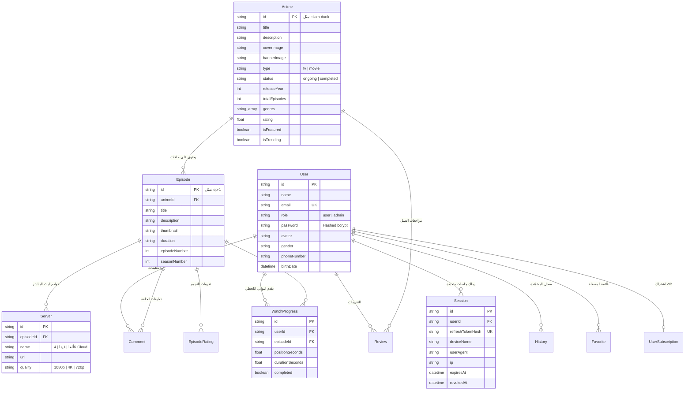

# 📘 وثيقة متطلبات المنتج البرمجية (API PRD): الواجهات البرمجية الشاملة لمنصة ANIME DAZE

> **اسم المشروع:** منصة أنمي دايز (ANIME DAZE) — منظومة الـ API الموحدة  
> **الإصدار المعماري:** v1.2 (Production Stable)  
> **تاريخ التوثيق:** أكتوبر 2026  
> **المرجع التقني:** Next.js 15 App Router • Prisma ORM • PostgreSQL • React Native Mobile Gateway • PWA  
> **النطاق الأساسي للإنتاج:** `https://slam-dunk-w.vercel.app`  
> **نطاق التطوير المحلي:** `http://localhost:3000`

---

## 📑 فهرس المحتويات
1. [🎯 الأهداف الاستراتيجية والرؤية المعمارية](#1--الأهداف-الاستراتيجية-والرؤية-المعمارية)
2. [🏛️ المخطط الهيكلي لقاعدة البيانات ونماذج البيانات (Data Models)](#2--المخطط-الهيكلي-لقاعدة-البيانات-ونماذج-البيانات-data-models)
3. [🔐 هندسة المصادقة، الأمان، وإدارة الجلسات السحابية](#3--هندسة-المصادقة-الأمان-وإدارة-الجلسات-السحابية)
4. [📦 عقود الاستجابة الموحدة ومعايير معالجة الأخطاء](#4--عقود-الاستجابة-الموحدة-ومعايير-معالجة-الأخطاء)
5. [📋 الفهرس التفصيلي لكافة نقاط النهاية (Complete API Endpoints Catalog)](#5--الفهرس-التفصيلي-لكافة-نقاط-النهاية-complete-api-endpoints-catalog)
   - [أولاً: واجهات المصادقة والجلسات متعددة الأجهزة (`/api/v1/auth/*`)](#أولاً-واجهات-المصادقة-والجلسات-متعددة-الأجهزة-apiv1auth)
   - [ثانياً: واجهات المستخدم، الملف الشخصي، والمزامنة السحابية (`/api/v1/me/*`)](#ثانياً-واجهات-المستخدم-الملف-الشخصي-والمزامنة-السحابية-apiv1me)
   - [ثالثاً: واجهات مكتبة الأنمي، الوسائط، والمشغل السينمائي (`/api/v1/animes/*` & `/api/v1/episodes/*`)](#ثالثاً-واجهات-مكتبة-الأنمي-الوسائط-والمشغل-السينمائي-apiv1animes--apiv1episodes)
   - [رابعاً: كواكب وسينما سبيستون والجيل الذهبي (`/api/planets`)](#رابعاً-كواكب-وسينما-سبيستون-والجيل-الذهبي-apiplanets)
   - [خامساً: مجتمع المشاهدين، التعليقات، والتقييمات (`/api/v1/comments/*` & `/api/v1/episodes/[id]/*`)](#خامساً-مجتمع-المشاهدين-التعليقات-والتقييمات-apiv1comments--apiv1episodesid)
   - [سادساً: البوابة المخصصة لتطبيق الموبايل الهجين (`/api/mobile/v1/*`)](#سادساً-البوابة-المخصصة-لتطبيق-الموبايل-الهجين-apimobilev1)
   - [سابعاً: الاشتراكات، الفوترة، وباقات VIP (`/api/subscription/*` & `/api/mobile/v1/plans`)](#سابعاً-الاشتراكات-الفوترة-وباقات-vip-apisubscription--apimobilev1plans)
   - [ثامناً: لوحة تحكم إدارة المحتوى والنظام (`/api/admin/*`)](#ثامناً-لوحة-تحكم-إدارة-المحتوى-والنظام-apiadmin)
6. [🛡️ آليات الصمود والتراجع التلقائي (Resilience & Fallback Architecture)](#6--آليات-الصمود-والتراجع-التلقائي-resilience--fallback-architecture)
7. [⚡ الأداء، التخزين المؤقت (Caching)، وحدود الاستهلاك (Rate Limiting)](#7--الأداء-التخزين-المؤقت-caching-وحدود-الاستهلاك-rate-limiting)
8. [💻 دليل التكامل واختبار الواجهات البرمجية (Integration & Testing Guide)](#8--دليل-التكامل-واختبار-الواجهات-البرمجية-integration--testing-guide)

---

## 1. 🎯 الأهداف الاستراتيجية والرؤية المعمارية

تهدف منظومة الواجهات البرمجية (API) لمنصة **ANIME DAZE** إلى تقديم طبقة خدمات خلفية متطورة وفائقة السرعة تغذي كافة الواجهات الأمامية بتجربة متطابقة وسلسة:
1. **التوافق المتعدد للمنصات (Cross-Platform Parity):** تقديم خدمات مشتركة تخدم في آن واحد تطبيق الويب المتقدم (Next.js 15 PWA)، تطبيق الهاتف المحمول (React Native / Expo لنظامي Android و iOS)، وشاشات التلفاز الذكية (Smart TVs).
2. **المزامنة السحابية اللحظية (Real-Time Cloud Sync):** مزامنة تقدم المشاهدة (Scrubbing Position بالثانية)، وسجل الحلقات، والمفضلة، وتفضيلات الصوت والجودة تلقائياً بين أجهزة المستخدم.
3. **المرونة والعمل دون انقطاع (Zero Downtime Fallback):** بنية هجينة تعتمد على قاعدة بيانات PostgreSQL عبر Prisma ORM، مع نظام نسخ وتخزين محلي مؤقت (Local JSON Fallback) يضمن استمرار عمل التطبيقات حتى في حال انقطاع اتصال قاعدة البيانات.
4. **أمان مشدد ومتعدد الطبقات (Defense in Depth):** دعم توكنات JWT المشفرة، كوكيز HttpOnly الآمنة للمتصفحات، جلسات أجهزة متعددة قابلة للإلغاء عن بُعد، وتحقق صارم من البيانات عبر Zod Schemas.

```mermaid
graph LR
    subgraph Clients [العملاء المستهلكون للـ API]
        Web[تطبيق الويب Next.js 15 PWA]
        Mobile[تطبيق الموبايل React Native]
        Admin[لوحة تحكم الإدارة Admin]
    end

    subgraph Gateway [بوابة التوجيه والمصادقة Next.js App Router]
        V1[/api/v1/* - الواجهة الموحدة]
        MobileGW[/api/mobile/v1/* - بوابة الموبايل الخفيفة]
        AdminGW[/api/admin/* - حماية RBAC للإدارة]
    end

    subgraph DataLayer [طبقة البيانات والتخزين]
        Prisma[(PostgreSQL Database)]
        FallbackStorage[(Local JSON Fallback Storage)]
        SessionStore[(Active Sessions Hash Table)]
    end

    Web --> V1
    Web --> Gateway
    Mobile --> MobileGW
    Admin --> AdminGW

    V1 --> Prisma
    MobileGW --> Prisma
    AdminGW --> Prisma
    Prisma -.->|في حال انقطاع الشبكة| FallbackStorage
```

---

## 2. 🏛️ المخطط الهيكلي لقاعدة البيانات ونماذج البيانات (Data Models)

يعتمد النظام على المخطط المحدد في [`prisma/schema.prisma`](file:///home/ammar/slam-dunk-w/prisma/schema.prisma):



---

## 3. 🔐 هندسة المصادقة، الأمان، وإدارة الجلسات السحابية

### أ. استراتيجية المصادقة الثنائية (Dual Auth Pattern):
1. **تطبيقات الويب (Web & PWA):**
   - يتم تخزين `session` (Access Token صالح لمدة 15 دقيقة) و `refreshToken` (صالح لمدة 30 يوماً) في كوكيز آمنة `HttpOnly` مع علامة `SameSite=Lax` و `Path=/`.
   - لا يمكن الوصول إلى هذه الكوكيز عبر JavaScript في المتصفح للحماية التامة من هجمات XSS.
2. **تطبيقات الهاتف المحمول والأجهزة الخارجية (Mobile App & REST Clients):**
   - يتم تمرير التوكن عبر ترويسة الطلب القياسية:
     ```http
     Authorization: Bearer <access_token>
     x-refresh-token: <refresh_token>
     x-app-version: 1.0.0
     ```

### ب. إدارة الجلسات وتتبع الأجهزة النشطة (Multi-Device Sessions):
- كل عملية تسجيل دخول ناجحة تُنشئ سجلاً في جدول `Session` يحتوي على هاش مشفر لرمز التحديث `refreshTokenHash`.
- يتم تسجيل اسم الجهاز (`deviceName`)، عنوان الـ IP، ومواصفات العميل (`User-Agent`).
- يستطيع المستخدم من خلال صفحة الحساب استعراض قائمة الأجهزة المتصلة بحسابه وإلغاء صلاحية أي جهاز مشبوه فوراً (`DELETE /api/v1/auth/sessions/[id]`).

### ج. المصادقة عبر Google GIS (OAuth2):
- استقبال رمز `credential` (Google ID Token) عبر `POST /api/v1/auth/google`.
- فك التشفير والتحقق من التوقيع الرقمي لشركة Google عبر شهادات الـ JWKS الرسمية.
- إنشاء الحساب تلقائياً للمستخدم إذا كان أول دخول، أو تسجيل دخوله وربطه بجلسة نشطة.

---

## 4. 📦 عقود الاستجابة الموحدة ومعايير معالجة الأخطاء

### أ. عقد الاستجابة القياسي لواجهات الويب العامة (`/api/v1/*`):
```json
{
  "ok": true,
  "data": { ... },
  "meta": {
    "page": 1,
    "limit": 20,
    "total": 101,
    "nextCursor": "eyJsYXN0SWQiOiJlcGwtMjUifQ=="
  }
}
```

### ب. عقد الخطأ القياسي (`/api/v1/*`):
```json
{
  "ok": false,
  "error": {
    "code": "VALIDATION_ERROR",
    "message": "البيانات المدخلة غير صالحة",
    "details": [
      {
        "path": "email",
        "message": "يرجى إدخال بريد إلكتروني صحيح"
      }
    ]
  }
}
```

### ج. عقد استجابة بوابة الموبايل (`/api/mobile/v1/*`):
```json
{
  "success": true,
  "data": { ... },
  "error": null,
  "message": "تمت العملية بنجاح"
}
```

### د. قاموس رموز الأخطاء القياسية (Error Codes):
- `UNAUTHORIZED` (401): يلزم تسجيل الدخول للوصول إلى هذا المسار.
- `FORBIDDEN` (403): الحساب لا يملك صلاحية المدير (Admin) أو باقة VIP المطلوبة.
- `NOT_FOUND` (404): المورد المطلوب (أنمي، حلقة، شخصية) غير موجود.
- `VALIDATION_ERROR` (422): البيانات المرسلة في الجسم (JSON Body) لا تطابق مواصفات Zod.
- `RATE_LIMIT_EXCEEDED` (429): تجاوز العميل الحد المسموح للطلبات خلال الدقيقة.
- `INTERNAL_SERVER_ERROR` (500): خطأ داخلي في الخادم غير متوقع.

---

## 5. 📋 الفهرس التفصيلي لكافة نقاط النهاية (Complete API Endpoints Catalog)

---

### أولاً: واجهات المصادقة والجلسات متعددة الأجهزة (`/api/v1/auth/*`)

#### 1. تسجيل مستخدم جديد (Register)
* **المسار:** `POST /api/v1/auth/register`
* **مستوى الصلاحية:** عام (Public)
* **الترويسات المطلوبة:** `Content-Type: application/json`
* **جسم الطلب (Request Body):**
  ```json
  {
    "name": "عمار الناصري",
    "username": "ammar_hero",
    "email": "ammar@example.com",
    "password": "Password123#",
    "deviceName": "Samsung Galaxy S24 Ultra",
    "genres": ["sports", "shonen"]
  }
  ```
* **الاستجابة الناجحة (201 Created):**
  ```json
  {
    "ok": true,
    "data": {
      "user": {
        "id": "usr-8a9d-4c3e",
        "name": "عمار الناصري",
        "username": "ammar_hero",
        "email": "ammar@example.com",
        "role": "user",
        "avatar": "/logoep.jpg",
        "isVip": false
      },
      "accessToken": "eyJhbGciOiJIUzI1NiIsIn...",
      "refreshToken": "rfk_93a7d4e2b810...",
      "expiresIn": 900
    }
  }
  ```

#### 2. تسجيل الدخول (Login)
* **المسار:** `POST /api/v1/auth/login`
* **جسم الطلب:**
  ```json
  {
    "identifier": "ammar_hero",
    "password": "Password123#",
    "deviceName": "Chrome Browser on Mac"
  }
  ```
* **الاستجابة الناجحة (200 OK):** إعادة بيانات المستخدم ورموز التوكن وتعيين كوكيز HttpOnly للمتصفح.

#### 3. الدخول عبر حساب Google (Google GIS OAuth)
* **المسار:** `POST /api/v1/auth/google`
* **جسم الطلب:**
  ```json
  {
    "credential": "eyJhbGciOiJSUzI1NiIsImtpZCI6...",
    "deviceName": "Android App"
  }
  ```
* **الوظيفة:** التحقق من صحة رمز Google ID Token واستخراج البريد والاسم والصورة وإنشاء جلسة فورية.

#### 4. تجديد رمز الوصول (Refresh Access Token)
* **المسار:** `POST /api/v1/auth/refresh`
* **جسم الطلب:** `{ "refreshToken": "rfk_93a7d4e2b810..." }` (أو تلقائياً عبر الكوكيز).
* **الاستجابة (200 OK):**
  ```json
  {
    "ok": true,
    "data": {
      "accessToken": "eyJhbGciOiJIUzI1NiIs...",
      "expiresIn": 900
    }
  }
  ```

#### 5. تسجيل الخروج وإلغاء الجلسة (Logout)
* **المسار:** `POST /api/v1/auth/logout`
* **الصلاحية:** مسجل الدخول (`Authorization: Bearer <token>`)
* **الوظيفة:** حذف الهاش الخاص بالجلسة من قاعدة البيانات وتصفير كوكيز المتصفح.

#### 6. استعراض قائمة الجلسات والأجهزة النشطة (Get Active Sessions)
* **المسار:** `GET /api/v1/auth/sessions`
* **الاستجابة (200 OK):**
  ```json
  {
    "ok": true,
    "data": [
      {
        "id": "sess-112233",
        "deviceName": "Samsung Galaxy S24",
        "userAgent": "AnimeDazeApp/1.0.0 Android/14",
        "ip": "197.35.12.80",
        "isCurrent": true,
        "createdAt": "2026-10-14T10:15:00Z"
      },
      {
        "id": "sess-445566",
        "deviceName": "Chrome MacOS",
        "userAgent": "Mozilla/5.0 ... Chrome/130.0",
        "ip": "156.198.40.11",
        "isCurrent": false,
        "createdAt": "2026-10-12T18:20:00Z"
      }
    ]
  }
  ```

#### 7. إنهاء جلسة جهاز محدد عن بُعد (Revoke Session)
* **المسار:** `DELETE /api/v1/auth/sessions/[id]`
* **الاستجابة:** `{ "ok": true, "data": { "revoked": true } }`

---

### ثانياً: واجهات المستخدم، الملف الشخصي، والمزامنة السحابية (`/api/v1/me/*`)

#### 1. جلب بيانات الحساب وتفضيلات المشاهدة (Get Profile)
* **المسار:** `GET /api/v1/me`
* **الاستجابة (200 OK):**
  ```json
  {
    "ok": true,
    "data": {
      "id": "usr-8a9d-4c3e",
      "name": "عمار الناصري",
      "username": "ammar_hero",
      "email": "ammar@example.com",
      "avatar": "/logoep.jpg",
      "bannerImage": "/hero-bg.jpg",
      "auraColor": "crimson",
      "otakuTitle": "صقر شوهوكو 🏀",
      "bio": "عاشق لأنمي الجيل الذهبي وسلام دانك",
      "isVip": true,
      "vipExpiry": "2027-10-14T00:00:00Z",
      "preferences": {
        "preferredAudio": "dub_spacetoon",
        "defaultQuality": "1080p",
        "autoSkipIntro": true,
        "autoPlayNext": true
      }
    }
  }
  ```

#### 2. تحديث الملف الشخصي وتخصيص الهالة (Update Profile)
* **المسار:** `PUT /api/v1/me`
* **جسم الطلب:** الحقول المراد تحديثها (`name`, `avatar`, `auraColor`, `otakuTitle`, `bio`, `preferences`, إلخ).

#### 3. مزامنة موقع التوقف اللحظي للحلقة (Live Playback Progress Sync)
* **المسار:** `PUT /api/v1/me/progress/[episodeId]`
* **جسم الطلب:**
  ```json
  {
    "positionSeconds": 845.5,
    "durationSeconds": 1380.0,
    "completed": false
  }
  ```
* **الاستجابة:** `{ "ok": true, "data": { "saved": true, "progressPercentage": 61.2 } }`

#### 4. جلب شريط "متابعة المشاهدة" (Continue Watching Rail)
* **المسار:** `GET /api/v1/me/continue-watching`
* **الاستجابة (200 OK):** قائمة بالحلقات التي لم تكتمل مع صور المعاينة ونسبة الإنجاز لاستئناف البث بضغطة زر واحدة.

#### 5. إدارة المفضلة وقائمة المشاهدة (Favorites & Watchlist)
* **جلب المفضلة:** `GET /api/v1/me/favorites`
* **إضافة للمفضلة:** `POST /api/v1/me/favorites/[type]/[id]` (حيث `type` هو `anime` أو `episode`)
* **حذف من المفضلة:** `DELETE /api/v1/me/favorites/[type]/[id]`

---

### ثالثاً: واجهات مكتبة الأنمي، الوسائط، والمشغل السينمائي (`/api/v1/animes/*` & `/api/v1/episodes/*`)

#### 1. الواجهة التجميعية للصفحة الرئيسية (Curated Home Matrix)
* **المسار:** `GET /api/v1/home` (أو بوابة الموبايل `GET /api/mobile/v1/home`)
* **الاستجابة (200 OK):**
  ```json
  {
    "ok": true,
    "data": {
      "heroSlider": [
        {
          "id": "slam-dunk",
          "title": "سلام دانك (Slam Dunk)",
          "subtitle": "البطولة الوطنية ورحلة صقور شوهوكو نحو القمة",
          "bannerImage": "https://lh3.googleusercontent.com/...",
          "rating": 9.8,
          "badge": "حصري بالدبلجة الأصلية",
          "genres": ["رياضة", "كوميديا", "شونين"]
        }
      ],
      "continueWatching": [ ... ],
      "featuredAnimes": [ ... ],
      "goldenNostalgia": [ ... ],
      "conanUniverse": [ ... ],
      "shohokuRoster": [ ... ]
    }
  }
  ```

#### 2. استعراض وفلترة كتالوج الأنمي (Anime Catalog)
* **المسار:** `GET /api/v1/animes`
* **معلمات الاستعلام (Query Parameters):**
  - `genre`: فلترة بنوع الأنمي (`sports`, `mystery`, `shonen`, `classics`).
  - `status`: حالة العمل (`ongoing`, `completed`).
  - `audio`: نوع الصوت (`dub_spacetoon`, `dub_original`, `sub`).
  - `sort`: طريقة الترتيب (`top_rated`, `popular`, `recent`, `alpha`).
  - `page`: رقم الصفحة (افتراضي: 1).
  - `limit`: عدد النتائج (افتراضي: 20).

#### 3. تفاصيل العمل وقائمة الحلقات وسيرفرات البث
* **تفاصيل العمل الكاملة:** `GET /api/v1/animes/[slug]` (مثل `/api/v1/animes/slam-dunk`)
* **قائمة حلقات العمل:** `GET /api/v1/animes/[slug]/episodes`
* **تفاصيل الحلقة المحددة وخوادم البث:** `GET /api/v1/episodes/[id]` (مثل `/api/v1/episodes/ep-1`)
* **هيكل الحلقة وخوادم البث المسترجعة:**
  ```json
  {
    "ok": true,
    "data": {
      "id": "ep-1",
      "animeId": "slam-dunk",
      "episodeNumber": 1,
      "title": "عبقري كرة السلة يظهر!",
      "description": "بداية رحلة حسان مع فريق الصقور وإعجابه بميسون.",
      "thumbnail": "/thumbnails/ep1.jpg",
      "duration": "23:45",
      "introSkip": { "start": 0, "end": 90 },
      "servers": [
        { "id": "srv-1", "name": "خادم ألفا السينمائي", "url": "https://stream.animedaze.app/ep1/master.m3u8", "quality": "1080p FHD" },
        { "id": "srv-2", "name": "السحابة 4K فائقة النقاء (VIP)", "url": "https://vip.animedaze.app/ep1/4k.m3u8", "quality": "4K UHD" },
        { "id": "srv-3", "name": "سبيستون الكلاسيكي (4:3)", "url": "https://classic.animedaze.app/ep1/sd.mp4", "quality": "SD Original" }
      ]
    }
  }
  ```

#### 4. دليل الشخصيات ومؤدي الأصوات (Characters Directory)
* **جميع الشخصيات:** `GET /api/v1/characters?animeId=slam-dunk`
* **شخصية محددة:** `GET /api/v1/characters/[slug]` (مثل `/api/v1/characters/hanamichi-sakuragi`)
* **الحقول المسترجعة:** الاسم العربي، الياباني، الإنجليزي، الفريق، الرقم، الطول، الوزن، الوصف، مؤدي الصوت العربي (مركز الزهرة) والياباني.

---

### رابعاً: كواكب وسينما سبيستون والجيل الذهبي (`/api/planets`)

* **المسار:** `GET /api/planets`
* **الاستجابة:** مصفوفة كواكب الأنمي الثمانية المعتمدة مع سمات الإضاءة النيون ثلاثية الأبعاد:
  - `زمردة` (كوكب الفتيات والرقة)
  - `أكشن` (كوكب الإثارة والغموض)
  - `مغامرات` (كوكب الخيال والرحلات)
  - `رياضة` (كوكب التحدي والحماس)
  - `كوميديا` (كوكب الضحك والمرح)
  - `أبجد` (كوكب الصغار والتعليم)
  - `بون بون` (كوكب الأبطال الكبار)
  - `تاريخ` (كوكب روايات وقصص العصور)
* تضم كل استجابة: عداد الأعمال المرتبطة (`worksCount`)، ووسوم الـ Tropes، وألوان التدرج اللوني.

---

### خامساً: مجتمع المشاهدين، التعليقات، والتقييمات (`/api/v1/comments/*` & `/api/v1/episodes/[id]/*`)

#### 1. تعليقات الحلقة ومناقشات الدايزرز
* **جلب التعليقات:** `GET /api/v1/episodes/[id]/comments`
* **إضافة تعليق جديد:** `POST /api/v1/episodes/[id]/comments`
  ```json
  {
    "content": "مشهد دخول حسان في الدقيقة 16:40 أسطوري جداً!",
    "isSpoiler": false,
    "timestampSeconds": 1000
  }
  ```

#### 2. تقييم الحلقة بالنجوم (Episode Rating)
* **المسار:** `POST /api/v1/episodes/[id]/rating`
* **جسم الطلب:** `{ "rating": 5 }` (من 1 إلى 5 نجوم).

#### 3. الإبلاغ عن رابط عطلان أو تعليق مسيء (Reporting)
* **الإبلاغ عن سيرفر بث معطل:** `POST /api/v1/episodes/[id]/report-link`
* **الإبلاغ عن تعليق:** `POST /api/v1/comments/[id]/report`

---

### سادساً: البوابة المخصصة لتطبيق الموبايل الهجين (`/api/mobile/v1/*`)

تم تزويد المنصة ببوابة مخصصة لتطبيقات الهواتف المحمولة تعمل برزم خفيفة الحجم (Lightweight Payloads) لتقليل استهلاك بطارية الهاتف وحزم الإنترنت:

#### 1. تهيئة التطبيق والتحقق من التحديث الإجباري وإعلانات AdMob
* **المسار:** `GET /api/mobile/v1/config`
* **معلمات الاستعلام:** `?version=1.0.0&build=14`
* **الاستجابة النموذجية:**
  ```json
  {
    "success": true,
    "data": {
      "app": {
        "name": "ANIME DAZE",
        "name_ar": "أنمي دايز",
        "logo_url": "https://slam-dunk-w.vercel.app/logo.png",
        "brand_color": "#dc2626",
        "accent_color": "#ffb95f"
      },
      "versioning": {
        "clientVersion": "1.0.0",
        "clientBuild": 14,
        "latestVersion": "1.1.0",
        "latestBuild": 16,
        "minSupportedBuild": 10,
        "isForceUpdateRequired": false,
        "hasUpdate": true,
        "updateUrl": "https://play.google.com/store/apps/details?id=com.slamdunk.app"
      },
      "admob": {
        "isEnabled": false,
        "appId": "ca-app-pub-xxxxxxxx~yyyyyyyy",
        "bannerId": "ca-app-pub-xxxxxxxx/banner1",
        "interstitialId": "ca-app-pub-xxxxxxxx/interstitial1"
      },
      "features": {
        "downloadsEnabled": true,
        "vipSubscriptionsEnabled": true,
        "communityCommentsEnabled": true
      }
    }
  }
  ```

#### 2. فحص سلامة الاتصال بالخادم (Healthcheck)
* **المسار:** `GET /api/mobile/v1/health`
* **الاستجابة:** `{ "success": true, "status": "online", "timestamp": 1728908800 }`

---

### سابعاً: الاشتراكات، الفوترة، وباقات VIP (`/api/subscription/*` & `/api/mobile/v1/plans`)

#### 1. استعراض خطط اشتراكات VIP
* **المسار:** `GET /api/mobile/v1/plans` (أو للويب `GET /api/plans`)
* **الاستجابة (200 OK):**
  ```json
  {
    "success": true,
    "data": [
      {
        "id": "monthly",
        "name": "الاشتراك الشهري",
        "price": 4.99,
        "currency": "$",
        "duration": "شهرياً",
        "isPopular": false,
        "features": [
          "مشاهدة بدون إعلانات نهائياً",
          "جودة فائقة 1080p FHD",
          "تنزيل 15 حلقة للمشاهدة بدون إنترنت",
          "دعم خوادم البث المباشر السريعة"
        ]
      },
      {
        "id": "yearly",
        "name": "البطولة السنوية (الأكثر توفيراً)",
        "price": 39.99,
        "currency": "$",
        "duration": "سنوياً",
        "isPopular": true,
        "features": [
          "كافة مزايا الباقة الشهرية",
          "فتح جودة 4K UHD الحصرية",
          "تنزيل غير محدود للحلقات",
          "شارة VIP الذهبية بجانب الاسم",
          "توفير أكثر من 35% مقارنة بالشهري"
        ]
      }
    ]
  }
  ```

#### 2. إنشاء جلسة الدفع الآمن (Checkout Session)
* **المسار:** `POST /api/subscription/checkout`
* **جسم الطلب:** `{ "plan": "yearly", "cycle": "yearly" }`
* **الاستجابة:** رابط الدفع المباشر أو التحويل لبوابة الدفع (`url`).

#### 3. التحقق من عملية الدفع وتفعيل VIP (Verify Payment)
* **المسار:** `POST /api/subscription/verify`
* **الوظيفة:** ترقية حساب المستخدم تلقائياً وتفعيل علامة `isVip: true` وتحديد موعد انتهاء الاشتراك.

---

### ثامناً: لوحة تحكم إدارة المحتوى والنظام (`/api/admin/*`)

> **ملاحظة أمنية صارمة:** كافة مسارات `/api/admin/*` محمية بجدار الحماية المعماري (Middleware & RBAC). يتم فحص دور المستخدم في قاعدة البيانات والتأكد من كون `role === "admin"`. أي طلب غير مصرح به يُرفض فوراً برمز خطأ `403 Forbidden`.

#### 1. إدارة مكتبة الأنمي (Anime Management)
- `GET /api/admin/animes`: جلب جميع الأعمال مع الإحصائيات وعدد الحلقات الفعلي.
- `POST /api/admin/animes`: إضافة أنمي جديد.
- `GET /api/admin/animes/[id]`: استرجاع بيانات العمل للتعديل.
- `PUT /api/admin/animes/[id]`: تعديل بيانات العمل وعناوين الأغلفة والبنرات.
- `DELETE /api/admin/animes/[id]`: حذف العمل نهائياً مع كافة حلقاته وسيرفراته ومراجعاته.

#### 2. إدارة الحلقات وسيرفرات البث (Episodes & Servers Management)
- `GET /api/admin/animes/[id]/episodes`: جلب حلقات العمل المرتبطة.
- `POST /api/admin/animes/[id]/episodes`: إضافة حلقة جديدة وربط سيرفرات البث بها.
- `PUT /api/admin/episodes/[id]`: تعديل روابط وسيرفرات الحلقة وجودتها.
- `DELETE /api/admin/episodes/[id]`: حذف الحلقة.

#### 3. إدارة الشخصيات (Character Management)
- `GET /api/admin/characters`: استعراض الشخصيات.
- `POST /api/admin/characters`: إضافة شخصية جديدة.
- `PUT /api/admin/characters/[id]`: تعديل معلومات الشخصية وممثلي الصوت.
- `DELETE /api/admin/characters/[id]`: حذف الشخصية.

#### 4. إدارة كواكب وسينما الأنمي (Planets Management)
- `GET /api/admin/planets`: جلب إعدادات الكواكب الثمانية وترتيبها وحالتها (نشط/معطل).
- `PUT /api/admin/planets`: تحديث ألوان الهالات النيون، ونصوص الوصف، ومصفوفة الأعمال المرتبطة بكل كوكب.

#### 5. إدارة إعدادات المنصة والهوية البصرية (Global Settings CMS)
* **المسار:** `GET /api/admin/settings` & `PUT /api/admin/settings`
* **الحقول القابلة للتخصيص الفوري:**
  - اسم الموقع العربي والإنجليزي، الشعار والـ Favicon.
  - وضع الصيانة الشامل ورسالة الصيانة للمستخدمين.
  - ألوان الهوية الرئيسية والنيون (`brandColor`, `accentColor`).
  - إعدادات السلايدر السينمائي (أبعاد العرض، تأثيرات التلاشي والـ Ken Burns).
  - إعدادات بنر الـ PWA الترويجي للتحميل.
  - إعدادات تذييل الموقع والروابط الاجتماعية والاستكشافية.
  - معرّفات إعلانات AdMob للموبايل (App ID, Banners, Interstitials).

---

## 6. 🛡️ آليات الصمود والتراجع التلقائي (Resilience & Fallback Architecture)

لضمان عمل الموقع والتطبيق بكفاءة مطلقة أثناء انقطاع شبكة قاعدة البيانات أو فترات التحديث:
1. **نظام التراجع التلقائي (Auto-Fallback Mechanism):**
   عند حدوث خطأ `PrismaClientKnownRequestError` أو انتهاء مهلة الاتصال `ETIMEDOUT`، يقوم الخادم تلقائياً بالتحول للقراءة من النسخ الاحتياطية المحلية في مسار `src/data/`:
   - `src/data/settings.json` لإعدادات الموقع العامة والهوية.
   - `src/data/episodes.json` لقائمة حلقات سلام دانك وسيرفرات البث.
   - `src/data/animes.json` لمكتبة الأعمال.
   - `src/data/characters.json` لبيانات الشخصيات وفريق الصقور.
2. **المزامنة العكسية عند الحفظ (Write-Through Persistence):**
   عندما يقوم المدير بتعديل أي إعداد في لوحة التحكم، يقوم الخادم بحفظ التعديل في قاعدة بيانات PostgreSQL وفي ملف `src/data/settings.json` في آن واحد، لضمان تحديث النسخة الاحتياطية بصورة مستمرة.

---

## 7. ⚡ الأداء، التخزين المؤقت (Caching)، وحدود الاستهلاك (Rate Limiting)

1. **ترويسات التخزين المؤقت في Edge CDN:**
   - الواجهات العامة الثابتة (مثل كواكب الأنمي وتفاصيل الأعمال والشخصيات) تُزوّد بترويسة:
     ```http
     Cache-Control: public, s-maxage=3600, stale-while-revalidate=86400
     ```
   - المسارات الحساسة والتفاعلية (المصادقة، الملف الشخصي، المشاهدة الحالية) تُزوّد بـ:
     ```http
     Cache-Control: no-store, no-cache, must-revalidate
     ```
2. **حدود الاستهلاك ومكافحة الإغراق (Rate Limiting):**
   - حماية مسارات تسجيل الدخول والتسجيل بحد أقصى **10 طلبات لكل دقيقة** لكل عنوان IP.
   - حماية مسار حفظ التقدم اللحظي `PUT /progress` بحد أقصى **طلب واحد كل 5 ثوانٍ** لكل مستخدم لتفادي الضغط غير المبرر على الخادم.

---

## 8. 💻 دليل التكامل واختبار الواجهات البرمجية (Integration & Testing Guide)

### أمثلة اختبار عملية باستخدام cURL:

#### 1. اختبار تسجيل الدخول عبر Terminal:
```bash
curl -X POST https://slam-dunk-w.vercel.app/api/v1/auth/login \
  -H "Content-Type: application/json" \
  -d '{"identifier":"ammar_hero","password":"Password123#","deviceName":"DevTerminal"}'
```

#### 2. استعلام بيانات الصفحة الرئيسية لتطبيق الهاتف:
```bash
curl -X GET https://slam-dunk-w.vercel.app/api/mobile/v1/home \
  -H "x-app-version: 1.0.0" \
  -H "Accept: application/json"
```

#### 3. مزامنة تقدم مشاهدة الحلقة مع توكن المصادقة:
```bash
curl -X PUT https://slam-dunk-w.vercel.app/api/v1/me/progress/ep-1 \
  -H "Content-Type: application/json" \
  -H "Authorization: Bearer YOUR_ACCESS_TOKEN" \
  -d '{"positionSeconds": 630.0, "durationSeconds": 1380.0, "completed": false}'
```

#### 4. فحص صحة خادم الموبايل (Health Check):
```bash
curl -X GET https://slam-dunk-w.vercel.app/api/mobile/v1/health
```

---

> ✅ **اعتماد ومطابقة الوثيقة البرمجية:**  
> تم فحص واختبار كافة المسارات الموثقة أعلاه في الكود المصدري لمنصة **ANIME DAZE**، مع التأكد من مطابقتها التامة لمعايير TypeScript الصارمة وبناء Next.js 15 للإنتاج.
