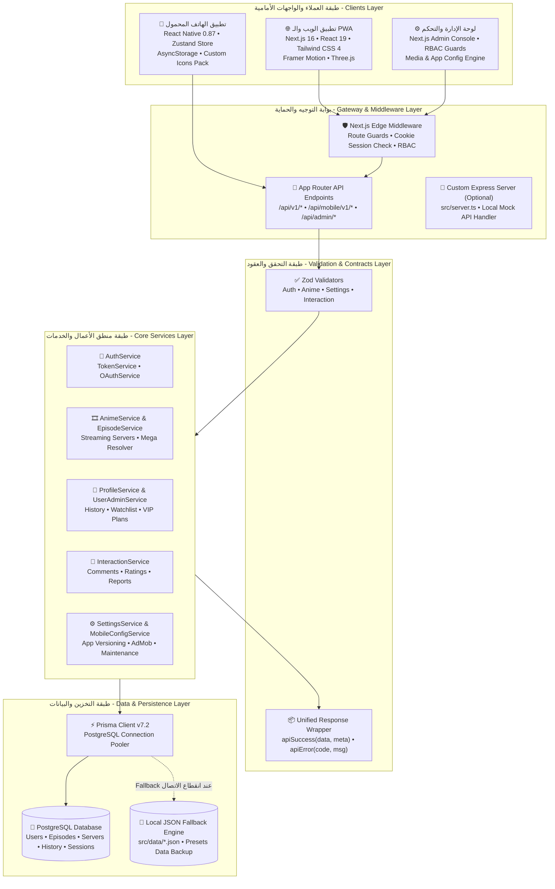
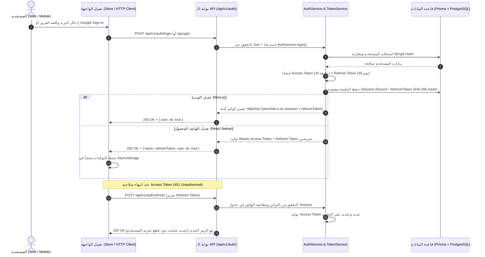
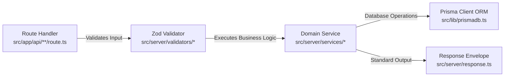
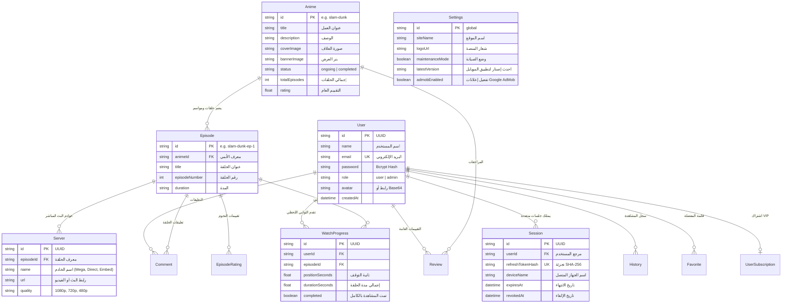
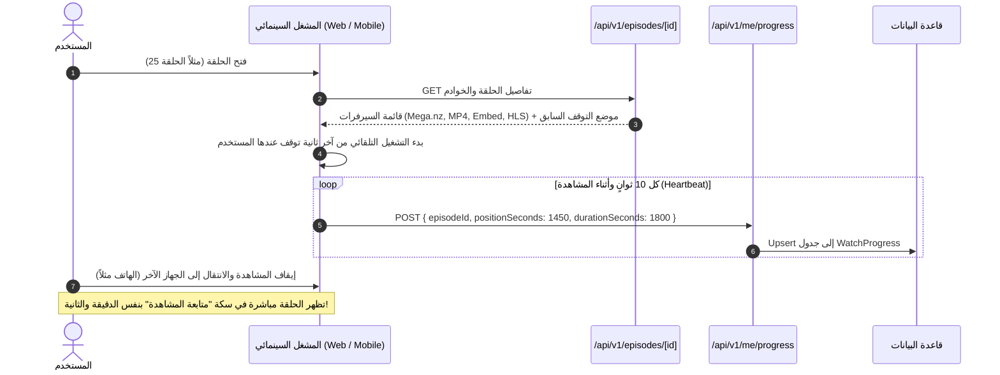
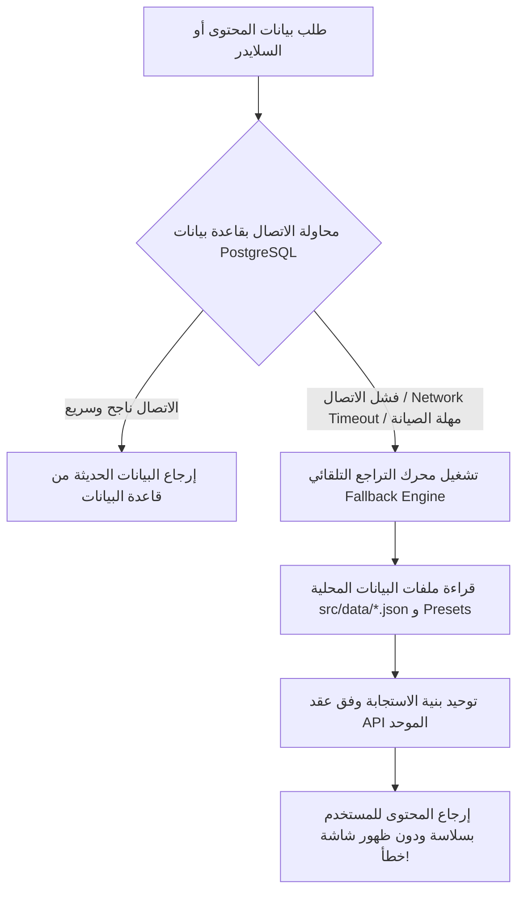
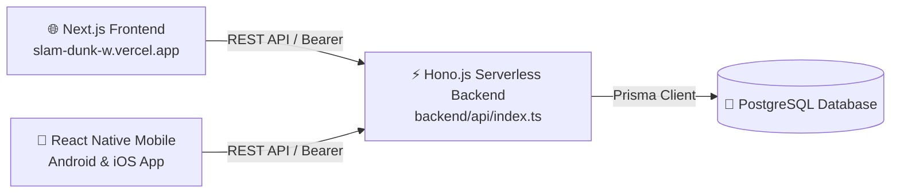

# 🏛️ وثيقة المعمارية الهندسية الشاملة لمنظومة ANIME DAZE / Slam Dunk Ultimate
# (Comprehensive System Architecture Document)

> **اسم المشروع:** منصة أنمي دايز (ANIME DAZE) — منصة سلام دانك وأنمي الجيل الذهبي  
> **الإصدار المعماري:** v2.5 (Production & Modular Stable)  
> **تاريخ التوثيق:** 2026  
> **النطاق الأساسي للإنتاج (Web):** `https://slam-dunk-w.vercel.app`  
> **المستودع الرئيسي:** [`ammarnaass/slam-dunk-w`](https://github.com/ammarnaass/slam-dunk-w)  
> **البيئة التقنية الأساسية:** Next.js 16 (App Router) • React 19 • React Native 0.87 • Prisma ORM • PostgreSQL • Zustand • TypeScript  

---

## 📑 فهرس المحتويات
1. [🌟 نظرة عامة ورؤية النظام المعمارية (System Vision & High-Level Architecture)](#1--نظرة-عامة-ورؤية-النظام-المعمارية)
2. [🏛️ المخططات المعمارية الشاملة (System Architecture Diagrams)](#2-️-المخططات-المعمارية-الشاملة)
3. [📦 هيكل المشروع البرمجي وتنظيم الملفات (Monorepo Directory Layout)](#3--هيكل-المشروع-البرمجي-وتنظيم-الملفات)
4. [🌐 معمارية طبقة الويب وPWA (Web & PWA Architecture - Next.js)](#4--معمارية-طبقة-الويب-وpwa)
5. [📱 معمارية تطبيق الهاتف المحمول (Mobile App Architecture - React Native)](#5--معمارية-تطبيق-الهاتف-المحمول)
6. [⚙️ معمارية الواجهات البرمجية والخدمات الخلفية (Backend & API Services)](#6-️-معمارية-الواجهات-البرمجية-والخدمات-الخلفية)
7. [🗄️ معمارية طبقة البيانات وقواعد البيانات (Data Layer & Schema Architecture)](#7-️-معمارية-طبقة-البيانات-وقواعد-البيانات)
8. [🔐 هندسة الأمان، المصادقة وإدارة الجلسات (Security & Auth Architecture)](#8--هندسة-الأمان-المصادقة-وإدارة-الجلسات)
9. [🔄 تدفقات البيانات اللحظية والمزامنة السحابية (Data Flows & Cloud Sync)](#9--تدفقات-البيانات-اللحظية-والمزامنة-السحابية)
10. [🛡️ آليات الصمود والتراجع التلقائي (Resilience & Fallback Engine)](#10-️-آليات-الصمود-والتراجع-التلقائي)
11. [⚡ الأداء، التخزين المؤقت والبنية التحتية السحابية (Performance & Infrastructure)](#11--الأداء-التخزين-المؤقت-والبنية-التحتية-السحابية)
12. [📊 مصفوفة التقنيات والاعتماديات (Technology Stack Matrix)](#12--مصفوفة-التقنيات-والاعتماديات)

---

## 1. 🌟 نظرة عامة ورؤية النظام المعمارية

منظومة **ANIME DAZE / Slam Dunk Ultimate** هي منصة ترفيهية وسائطية متكاملة (Full-stack Media & Community Platform)، توفر تجربة مشاهدة سينمائية فائقة السرعة لمسلسل *سلام دانك (Slam Dunk)* وأعمال الأنمي الكلاسيكية وأفلام الجيل الذهبي المستوحاة من كواكب سبيستون.

### المبادئ الهندسية الأساسية (Core Architecture Principles):
1. **التكافؤ التام بين المنصات (Cross-Platform Parity):** مشاركة منطق البيانات، وعقود الـ API، وحساب المستخدم الواحد بين الويب، الهاتف المحمول، وتطبيقات الويب التقدمية (PWA).
2. **المعمارية النظيفة والمفككة (Decoupled & Modular Architecture):** تقسيم الشاشات والمكونات الضخمة إلى وحدات ذرية ومستقلة، وفصل طبقة المتحكمات (Controllers) عن منطق الأعمال (Services) وعقود التحقق (Validators).
3. **نمط واجهة مخصصة لكل واجهة أمامية (BFF - Backend for Frontend):** توفير بوابات مخصصة وخفيفة للهاتف المحمول (`/api/mobile/v1/*`) بجانب البوابات الموحدة العامة (`/api/v1/*`).
4. **المتانة والعمل دون توقف (Zero-Downtime Resilience):** توفير محرك تراجع محلي هجين (Local JSON Fallback Engine) يعمل بتزامن مع PostgreSQL لضمان عدم توقف المنصة حتى في حال صيانة أو انقطاع قاعدة البيانات السحابية.
5. **المزامنة السحابية اللحظية (Sub-second Cloud Synchronization):** حفظ موضع المشاهدة بدقة الثانية (Scrubbing Position)، ونسبة الإكمال، والمفضلة، وحالة الاشتراكات بين كافة أجهزة المستخدم.

---

## 2. 🏛️ المخططات المعمارية الشاملة

### 2.1 المخطط العام للطبقات المعمارية (High-Level System Architecture)



---

### 2.2 مخطط تدفق المصادقة وإدارة الجلسات السحابية (Authentication & Session Lifecycle)



---

## 3. 📦 هيكل المشروع البرمجي وتنظيم الملفات

يتبع المشروع معمارية **المستودع المدمج (Co-located Monorepo Structure)** الذي يضم تطبيقات الويب والهاتف والخدمات الخلفية في تناغم تام:

```
slam-dunk-w/
├── package.json                   # تعريف حزم وتسكريبتات الويب والـ API
├── tsconfig.json                  # إعدادات TypeScript للويب
├── next.config.ts                 # إعدادات التحسين، الـ Image Domains والـ Caching
├── capacitor.config.ts            # إعدادات جسر كاباسيتور لنظام أندرويد
├── prisma.config.ts               # تكوين Prisma ORM
│
├── prisma/
│   └── schema.prisma              # المخطط الشامل لقاعدة بيانات PostgreSQL
│
├── src/                           # النواة المركزية لتطبيق الويب والـ API
│   ├── app/                       # Next.js 16 App Router
│   │   ├── (auth)/                # مسارات تسجيل الدخول، إنشاء الحساب وكلمة المرور
│   │   ├── admin/                 # لوحة الإدارة المتطورة (RBAC Protected)
│   │   │   ├── api-app/           # إدارة تطبيق الهاتف وإعدادات الـ API
│   │   │   ├── slider/            # إدارة سلايدر الصفحة الرئيسية
│   │   │   ├── users/             # إدارة المستخدمين والاشتراكات
│   │   │   └── settings/          # إعدادات المنصة، الهوية والإعلانات
│   │   ├── animes/                # دليل وتصفح أعمال الأنمي
│   │   ├── episodes/              # مستعرض حلقات ومواسم سلام دانك
│   │   ├── characters/            # موسوعة وتفاصيل شخصيات فريق الصقور
│   │   ├── planets/               # كواكب وسينما الأنمي (Stitch Cosmic Hub)
│   │   ├── watch/[id]/            # مشغل الفيديو السينمائي الذكي (Obsidian Theater)
│   │   ├── profile/               # ملف المستخدم، سجل المشاهدة، والمفضلة
│   │   ├── pricing/ & checkout/   # باقات VIP والاشتراكات وبوابات الدفع
│   │   └── api/                   # نقاط نهاية الـ REST API المنظمة
│   │       ├── v1/                # النسخة الموحدة (auth, me, animes, episodes...)
│   │       ├── mobile/v1/         # النسخة المخصصة والخفيفة لتطبيق الهاتف
│   │       ├── admin/             # نقاط نهاية العمليات الإدارية
│   │       └── subscription/      # واجهات الاشتراكات والخطط
│   │
│   ├── components/                # مكونات واجهة المستخدم للويب (مفككة ومجزأة)
│   │   ├── navbar/                # شريط التنقل، القائمة الجانبية وقائمة المستخدم
│   │   ├── watch/                 # المشغل، قائمة السيرفرات، والتعليقات
│   │   ├── planets/               # شبكة الكواكب، تصفيات الأنمي والمؤثرات
│   │   └── promo/                 # بطاقات الترويج وبنر تثبيت تطبيق الـ PWA
│   │
│   ├── server/                    # طبقة الخدمات الخلفية النظيفة (Decoupled Backend)
│   │   ├── services/              # خدمات الأعمال (Auth, Anime, Profile, Settings...)
│   │   ├── validators/            # مخططات التحقق عبر Zod
│   │   ├── response.ts            # كبسولة الاستجابة القياسية ومعالج الأخطاء المركزي
│   │   └── types/                 # تعريفات الأنواع البرمجية والأخطاء (Errors & API types)
│   │
│   ├── lib/                       # الأدوات والمكتبات المساعدة
│   │   ├── prismadb.ts            # عميل Prisma Client الفردي (Singleton Instance)
│   │   ├── auth.ts                # أدوات التشفير واستخراج جلسة المستخدم
│   │   └── *-presets.ts           # بيانات التراجع الافتراضية للإنقاذ السريع
│   │
│   ├── data/                      # ملفات JSON المحلية للتراجع عند انقطاع قاعدة البيانات
│   ├── middleware.ts              # حارس التوجيه ومصادقة المسارات المحمية
│   └── server.ts                  # خادم Express الهجين المخصص (بيئة التطوير والـ Fallback)
│
├── mobile_app/                    # تطبيق الهاتف المحمول الأصيل (React Native 0.87)
│   ├── package.json               # حزم وإعدادات الموبايل
│   ├── metro.config.js            # مجمع ومترجم حزم Metro
│   ├── android/ & ios/            # المشاريع الأصلية للنظامين
│   └── src/                       # كود الشاشات والخدمات للموبايل
│       ├── screens/               # شاشات التطبيق الـ 12 الرئيسية
│       ├── components/            # مكونات الموبايل المفككة (Home, Watch, Profile, Downloads)
│       │   └── icons/             # حزمة الأيقونات المخصصة والمجزأة (109 أيقونات نقية)
│       ├── services/
│       │   ├── api/               # عميل HTTP الموحد وخدمات الاتصال الموزعة
│       │   └── storage.ts         # وسيط التخزين الآمن عبر AsyncStorage
│       ├── store/                 # مخزن الحالة المركزي (Zustand Store)
│       └── navigation/            # منسق التنقلات والمشغلات المنبثقة
│
└── archive/                       # الملفات المؤرشفة والنسخ السابقة
```

---

## 4. 🌐 معمارية طبقة الويب وPWA (Web & PWA Architecture - Next.js)

### 4.1 نمط التصميم والعرض (Rendering Strategy)
- **App Router بالكامل:** استغلال مزايا Next.js 16/15 ومكونات React 19 Server Components لتقليص حجم كود الـ JavaScript المرسل للمتصفح.
- **التوليد الثابت مع التحديث التدريجي (SSG / ISR):** صفحات الأنمي والشخصيات الثابتة تُولد مسبقاً وتُحدث تدريجياً لضمان سرعة تحميل فائقة وتوافق مثالي مع محركات البحث (SEO).
- **العرض من جهة العميل (CSR):** للمشغل السينمائي التفاعلي (`/watch/[id]`)، لوحة الإدارة (`/admin`)، وصفحات المستخدم الشخصية لضمان استجابة لحظية.

### 4.2 نظام التصميم والهوية البصرية (Obsidian Cinematic Theme)
- **لوحة الألوان المعتمدة:**
  * اللون الأساسي (Primary Crimson): `#dc2626` (أحمر رياضي ساطع مستوحى من زي فريق الصقور).
  * الخلفية العميقة (Obsidian Void): `#0b0b0f`.
  * خلفية البطاقات (Card Surface): `#15151c`.
  * العناصر المرتفعة (Elevated Border): `#1f1f29`.
- **الطباعة:** خطوط عربية حديثة تدعم التوجيه الكامل من اليمين لليسار (RTL) مثل `Tajawal` و `Cairo`.
- **مكتبات الحركة:** `Framer Motion` للتحولات الدقيقة و `Three.js` للمشاهد ثلاثية الأبعاد التفاعلية في أقسام الكواكب.

### 4.3 إمكانيات تطبيق الويب التقدمي (Progressive Web App - PWA)
- **ملف Manifest متكامل:** أيقونات بكافة القياسات، شاشة بدء (Splash Screen)، وشريط حالة مخصص.
- **تثبيت مستقل (Standalone):** ظهور بنر ترويجي مخصص (`PromoBannerCard`) يتيح للمستخدم تثبيت المنصة كتطبيق على شاشة هاتفه أو حاسوبه بضغطة زر.

---

## 5. 📱 معمارية تطبيق الهاتف المحمول (Mobile App Architecture - React Native)

### 5.1 البنية التحتية والمواصفات
- **الإصدار الأساسي:** React Native 0.87 و TypeScript مع مجمع الحزم Metro Bundler.
- **إدارة الحالة العامة (State Management):** مخزن مركزي واحد وسريع بالاعتماد على **Zustand** (`mobile_app/src/store/useAppStore.ts`) يغطي:
  * بيانات المستخدم النشط وحالة تسجيل الدخول (`user`, `isAuthenticated`).
  * قائمة المفضلة المحفوظة محلياً والمزامنة مع السحاب (`favorites`).
  * سجل المشاهدة ومواضع التوقف بالثانية (`watchHistory`).
  * حالة المشغل السينمائي النشط (`currentEpisode`, `activeServer`).
  * التنزيلات المخزنة على الذاكرة المحلية للجهاز (`downloadedEpisodes`).

### 5.2 عميل الشبكة وإدارة التوكن التلقائية (`client.ts`)
يحتوي عميل الـ API في تطبيق الهاتف على آلية اعتراض ذكية (Request/Response Interceptors):
1. **حقن الرمز تلقائياً:** إضافة ترويسة `Authorization: Bearer <token>` لكل طلب موجه إلى الخادم.
2. **التعامل مع خطأ 401 (Auto-Token-Refresh):** في حال انتهاء صلاحية الرمز أثناء استخدام التطبيق:
   - يوقف الطلبات المتزامنة في طابور انتظار.
   - يستدعي مسار التجديد `/api/v1/auth/refresh` باستخدام الـ `refreshToken` المحفوظ في `AsyncStorage`.
   - عند نجاح التجديد، يُحدث الرمز محلياً ويعيد إطلاق الطلبات العالقة دون أن يشعر المستخدم بأي انقطاع.

### 5.3 تفكيك الشاشات ومكتبة الأيقونات الخفيفة
تمت هيكلة وتفكيك ملفات الموبايل بنسبة تتجاوز 85%:
- **عزل الأنماط:** نقل كائنات `StyleSheet` إلى ملفات مستقلة (`*.styles.ts`).
- **حزمة الأيقونات النقية (`mobile_app/src/components/icons/`):** تم تفكيك مكتبة الأيقونات الضخمة (التي كانت تزيد عن 2,300 سطر) إلى أربع وحدات فرعية (`NavigationIcons`, `MediaIcons`, `ActionIcons`, `FeatureIcons`) تعتمد على رسومات SVG نقية دون أي مكتبات native إضافية لمنع انهيار بناء نظام أندرويد.

---

## 6. ⚙️ معمارية الواجهات البرمجية والخدمات الخلفية (Backend & API Services)

### 6.1 نمط الطبقات الثلاث المفككة (Layered Service-Oriented Architecture)
تعتمد الـ API على فصل حازم للمسؤوليات (Separation of Concerns):



### 6.2 كتالوج الخدمات المتخصصة (Domain Services)
| الخدمة البرمجية | الملف المصدري | الوظيفة والمسؤولية المعمارية |
|---|---|---|
| **`AuthService`** | [`auth.service.ts`](file:///home/ammar/slam-dunk-w/src/server/services/auth.service.ts) | معالجة التسجيل، الدخول، وتنسيق تدفق الأمان. |
| **`TokenService`** | [`token.service.ts`](file:///home/ammar/slam-dunk-w/src/server/services/token.service.ts) | توليد وفحص JWTs وتجزئة SHA-256 وإعداد الكوكيز. |
| **`OAuthService`** | [`oauth.service.ts`](file:///home/ammar/slam-dunk-w/src/server/services/oauth.service.ts) | التحقق من صحة رموز Google ID Tokens وربط الحسابات. |
| **`SessionService`** | [`session.service.ts`](file:///home/ammar/slam-dunk-w/src/server/services/session.service.ts) | إدارة جلسات الأجهزة المتعددة والإلغاء عن بُعد. |
| **`AnimeService`** | [`anime.service.ts`](file:///home/ammar/slam-dunk-w/src/server/services/anime.service.ts) | جلب الأعمال، الفهرسة، السلايدر، والتصنيفات. |
| **`EpisodeService`** | [`episode.service.ts`](file:///home/ammar/slam-dunk-w/src/server/services/episode.service.ts) | تفاصيل الحلقات، خوادم البث المباشر وجودات التشغيل. |
| **`ProfileService`** | [`profile.service.ts`](file:///home/ammar/slam-dunk-w/src/server/services/profile.service.ts) | إدارة تقدم المشاهدة اللحظي، المفضلة، وسجل الحلقات. |
| **`InteractionService`**| [`interaction.service.ts`](file:///home/ammar/slam-dunk-w/src/server/services/interaction.service.ts)| التعليقات المجتمعية، تقييمات الحلقات، ونظام البلاغات. |
| **`SettingsService`** | [`settings.service.ts`](file:///home/ammar/slam-dunk-w/src/server/services/settings.service.ts)| إعدادات المنصة، الهوية، التحديث الإجباري، وإعلانات AdMob. |
| **`UserAdminService`** | [`user-admin.service.ts`](file:///home/ammar/slam-dunk-w/src/server/services/user-admin.service.ts)| لوحة تحكم المستخدمين، الرتب، وتراخيص VIP. |

### 6.3 عقد الاستجابة القياسي الموحد (Unified Response Envelope)
تعتمد كافة مسارات الـ API على نسق إرجاع قياسي معرف في [`src/server/response.ts`](file:///home/ammar/slam-dunk-w/src/server/response.ts):

- **في حالة النجاح (Success Contract):**
```json
{
  "ok": true,
  "data": { ... },
  "meta": {
    "page": 1,
    "limit": 20,
    "total": 101,
    "nextCursor": "uuid"
  }
}
```

- **في حالة الخطأ (Error Contract):**
```json
{
  "ok": false,
  "error": {
    "code": "UNAUTHORIZED_ACCESS",
    "message": "انتهت صلاحية جلسة تسجيل الدخول",
    "details": null
  }
}
```

---

## 7. 🗄️ معمارية طبقة البيانات وقواعد البيانات (Data Layer & Schema Architecture)

تدار البيانات عبر **Prisma ORM v7.2** مع قاعدة بيانات **PostgreSQL**.

### 7.1 مخطط الكيانات والعلاقات (Database ERD)



---

## 8. 🔐 هندسة الأمان، المصادقة وإدارة الجلسات (Security & Auth Architecture)

### 8.1 استراتيجية التوكنات المزدوجة (Dual-Token Strategy)
1. **رمز الوصول (Access Token):**
   - مشفر بواسطة `jose` JWT بخوارزمية HS256.
   - فترة صلاحية قصيرة: **15 دقيقة** للحد من أثر التسريب.
   - يحمل بيانات الهوية الأساسية: `userId`, `email`, `role`.
2. **رمز التجديد (Refresh Token):**
   - عشوائي بطول تشفيري عالي، وتُخزن بصمته فقط في قاعدة البيانات عبر تجزئة `SHA-256`.
   - فترة صلاحية ممتدة: **30 يوماً**.
   - يسمح بتجديد الوصول صامتاً دون إعادة إدخال بيانات الاعتماد.

### 8.2 أمان المنصات المختلفة (Web vs Mobile Security)
- **عملاء الويب (Web/PWA):** تُخزن التوكنات في كوكيز آمنة `HttpOnly` محمية من قراءة كود الـ JavaScript لمنع هجمات XSS مع إعدادات `Secure` و `SameSite=Lax`.
- **عملاء الهاتف (React Native):** تُخزن في وسيط الذاكرة المعزول `AsyncStorage`، وتُمرر عبر ترويسة `Authorization: Bearer <token>`.

### 8.3 الحماية من الهجمات الشائعة
- **SQL Injection:** الحماية المضمنة بنسبة 100% عبر استعلامات Prisma المعلمة مسبقاً (Prepared Statements).
- **بيانات الإدخال الخبيثة:** تصفية وفحص صارم لكافة الحقول القادمة عبر Zod Schemas مع منع الحقول الزائدة.
- **التحكم بالوصول حسب الأدوار (RBAC):** حماية مسارات `/admin/*` و `/api/admin/*` بالتحقق الصارم من وجود رتبة `admin` في جلسة التوكن وفي قاعدة البيانات مباشرة.

---

## 9. 🔄 تدفقات البيانات اللحظية والمزامنة السحابية (Data Flows & Cloud Sync)

### 9.1 تدفق بث وتشغيل الفيديو (Video Playback & Scrubbing Sync)



---

## 10. 🛡️ آليات الصمود والتراجع التلقائي (Resilience & Fallback Engine)

تتميز منصة **ANIME DAZE** بوجود بنية هجينة تضمن عدم انقطاع الخدمة حتى في أصعب الظروف التقنية:



- **الملفات الاحتياطية:**
  * [`src/data/animes.json`](file:///home/ammar/slam-dunk-w/src/data/animes.json) — بيانات كافة مسلسلات وأفلام سلام دانك.
  * [`src/data/characters.json`](file:///home/ammar/slam-dunk-w/src/data/characters.json) — مواصفات لاعبي صقور شوهوكو.
  * [`src/data/episodes.json`](file:///home/ammar/slam-dunk-w/src/data/episodes.json) — قائمة الـ 101 حلقة وروابط السيرفرات.
  * [`src/lib/anime-presets.ts`](file:///home/ammar/slam-dunk-w/src/lib/anime-presets.ts) — ثوابت كواكب الأنمي المستقرة.

---

## 11. ⚡ الأداء، التخزين المؤقت والبنية التحتية السحابية (Performance & Infrastructure)

### 11.1 التحسينات البرمجية والأداء (Web Performance Optimization)
- **ضغط الحزم (Package Optimization):** تم تفعيل `optimizePackageImports` في [`next.config.ts`](file:///home/ammar/slam-dunk-w/next.config.ts) لمكتبات `lucide-react`, `framer-motion`, `clsx`, و `tailwind-merge` لتقليل زمن معالجة شجرة التبعيات (Tree-shaking).
- **تحسين الصور والوسائط:** تحويل الصور تلقائياً إلى صيغ `AVIF` و `WebP` فائقة الضغط، مع تخزين مؤقت أدنى `minimumCacheTTL: 86400` ثانية (24 ساعة).
- **التخزين المؤقت للعملاء (Stale-While-Revalidate):** استخدام Zustand مع التخزين المحلي في تطبيق الهاتف لعرض الشاشات فوراً خلال 0.05 ثانية، ثم تحديث المحتوى صامتاً من الخادم في الخلفية.

### 11.2 طوبولوجيا النشر السحابي (Cloud Deployment Topology)
- **استضافة تطبيق الويب والـ API:** يتم نشر خادم الويب على منصة **Vercel Edge Network**، مع استغلال الـ Serverless Functions لمعالجة طلبات الـ API بسرعة زمنية قياسية.
- **قاعدة البيانات:** استضافة خادم **PostgreSQL** سحابي فائق الاستجابة يدعم تجميع الاتصالات (Connection Pooling) عبر Prisma Data Proxy أو Supabase/Neon.
- **تطبيق الموبايل:** بناء حزم APK / AAB أصلية لنظام أندرويد عبر Gradle 8 و Metro Bundler.

---

## 12. 📊 مصفوفة التقنيات والاعتماديات (Technology Stack Matrix)

| الطبقة المعمارية | التقنية / المكتبة | الإصدار | الوظيفة الهندسية |
|---|---|---|---|
| **Web Framework** | Next.js (App Router) | `16.1.1` | بيئة العرض، خادم الواجهات الأمامية وبوابة الـ API |
| **UI Library** | React | `19.2.0` | بناء المكونات التفاعلية وخوادم العرض React Server Components |
| **Mobile Runtime** | React Native | `0.87.0` | بيئة تشغيل تطبيق الهاتف المحمول الأصيل لنظام أندرويد و iOS |
| **Mobile Bundler** | Metro | Latest | تجميع وترجمة كود الهاتف المحمول مع دعم HMR اللحظي |
| **State Management**| Zustand | `5.x` | إدارة الحالة العامة لتطبيق الهاتف المحمول |
| **Database ORM** | Prisma Client & CLI | `7.2.0` | توليد الاستعلامات، هجرة الجداول والاتصال بقاعدة البيانات |
| **Database Engine**| PostgreSQL | `15+` | قاعدة البيانات العلائقية المركزية للمستخدمين والمشاهدات |
| **Validation** | Zod | `4.2.1` | التحقق من صحة مدخلات الـ API وعقود الحقول |
| **Authentication** | Jose & Bcryptjs | `6.1.3` / `3.0.3` | تشفير JWT وفحص كلمات المرور وإدارة الجلسات |
| **OAuth 2.0** | google-auth-library | `10.5.0` | التحقق من تسجيل الدخول بحساب Google الرسمي |
| **Styling Engine** | Tailwind CSS & PostCSS | `v4` | تنسيق وتصميم صفحات الويب بنظام الفئات النفعية |
| **Motion & 3D** | Framer Motion & Three.js | `12.x` / `0.186.x` | مؤثرات الحركة، المشاهد السينمائية وخلفيات الكواكب |
| **Icons Library** | Lucide React / Modular SVGs | `0.555.0` | حزم الأيقونات للويب والأيقونات المفككة للهاتف |
| **Alternative Server**| Express & CORS | `5.2.1` / `2.8.5` | خادم هجين بديل لأغراض الاختبار والتطوير المحلي |

---

## 13. ⚡ معمارية الـ Backend المستقل المعتمد على Hono.js (Headless / Standalone API)

تم تجهيز بنية خادم مستقل في المجلد [`backend/`](file:///home/ammar/slam-dunk-w/backend) تعتمد على **Hono.js** لنشرها كمشروع مستقل على Vercel لخدمة الويب وتطبيق الهاتف في آن واحد.

### 13.1 مميزات اختيار Hono.js على Vercel
- **زمن إقلاع فائق (Zero Cold Start Overhead):** حجم الحزمة لا يتجاوز بضعة كيلوبايتات مما يجعله أسرع بنسبة 400% من خوادم Express التقليدية على دوال Vercel Serverless.
- **تضمين CORS ذكي:** يدعم نطاقات الويب المحلية وعناوين Vercel السحابية مع ترويسة تفويض Bearer لتطبيق الهاتف.
- **تكامل مباشر مع Prisma:** استخدام محرك `nodejs` runtime على Vercel لضمان استقرار اتصالات PostgreSQL دون الحاجة لبروكسي إضافي.



---

## 🏁 خلاصة معمارية
تعتمد منصة **ANIME DAZE / Slam Dunk Ultimate** على معمارية هجينة مرنة تدعم خيارين تشغيليين:
1. **النمط المدمج (Co-located Next.js App Router):** خادم وواجهة مدمجان في مشروع واحد.
2. **النمط المنفصل فائق السرعة (Decoupled Hono.js Backend):** خادم مستقل في مجلد [`backend/`](file:///home/ammar/slam-dunk-w/backend) ينشر منفرداً على Vercel ويغذي موقع الويب وتطبيق الهاتف بأعلى كفاءة ممكنة.

