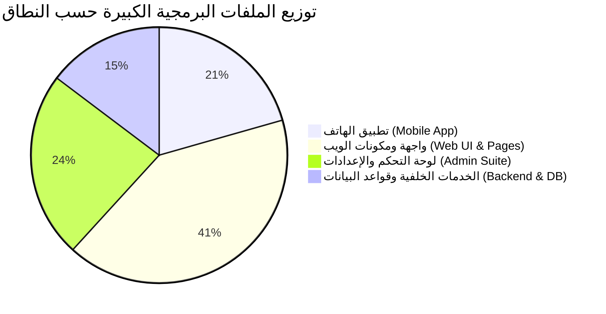

# تقرير التحليل الشامل للملفات البرمجية الكبيرة (Large Code Files Analysis)
**مشروع منصة ANIME DAZE & تطبيق الهاتف المحمول**  
**تاريخ التحليل:** أكتوبر 2026  
**نطاق الفحص:** 278 ملفاً برمجياً في المشروع (Next.js Web + React Native Mobile + Backend Services)

---

## 1. الملخص التنفيذي والإحصائيات العامة (Executive Summary)

أظهر التحليل البرمجي الشامل للمشروع وجود مجموعة من الملفات ذات الكثافة البرمجية العالية التي تجاوزت المعايير القياسية للهندسة النظيفة (Clean Code Architecture). تتوزع هذه الملفات بين شاشات لوحة التحكم، واجهات تجربة المستخدم، ومكونات الأيقونات، والخدمات المركزية.

### إحصائيات التوزيع بحسب حجم الملفات:
- **ملفات عملاقة جداً (> 1,000 سطر كود):** **6 ملفات** (تتطلب تفكيكاً وإعادة هيكلة عاجلة).
- **ملفات كبيرة (> 500 إلى 1,000 سطر كود):** **11 ملفاً** (تتطلب استخراج مكونات فرعية و Hooks).
- **ملفات متوسطة إلى كبيرة (300 إلى 500 سطر كود):** **14 ملفاً** (تتطلب تنظيم منطق الحالة).
- **ملفات البيانات الكثيفة (JSON / Prisma):** **3 ملفات** (تضم آلاف أسطر التكوين والحلقات).

---

## 2. جدول حصر الملفات الكبيرة (Top Large Files Ranking)

| # | مسار الملف (File Path) | عدد الأسطر (LOC) | الحجم (KB) | النطاق (Scope) | درجة أولوية التفكيك |
|---|---|---|---|---|---|
| **1** | [`mobile_app/src/components/Icon.tsx`](file:///home/ammar/slam-dunk-w/mobile_app/src/components/Icon.tsx) | **2,307** | 63.8 KB | تطبيق الهاتف | 🔴 حرجة جداً |
| **2** | [`src/data/episodes.json`](file:///home/ammar/slam-dunk-w/src/data/episodes.json) | **2,202** | 75.7 KB | قاعدة بيانات محلية | 🟡 متوسطة (ملف بيانات) |
| **3** | [`mobile_app/src/screens/DownloadsScreen.tsx`](file:///home/ammar/slam-dunk-w/mobile_app/src/screens/DownloadsScreen.tsx) | **1,546** | 48.8 KB | تطبيق الهاتف | 🔴 حرجة جداً |
| **4** | [`mobile_app/src/screens/ProfileScreen.tsx`](file:///home/ammar/slam-dunk-w/mobile_app/src/screens/ProfileScreen.tsx) | **1,317** | 38.9 KB | تطبيق الهاتف | 🔴 حرجة جداً |
| **5** | [`mobile_app/src/screens/HomeScreen.tsx`](file:///home/ammar/slam-dunk-w/mobile_app/src/screens/HomeScreen.tsx) | **1,294** | 41.8 KB | تطبيق الهاتف | 🔴 حرجة جداً |
| **6** | [`mobile_app/src/screens/WatchModal.tsx`](file:///home/ammar/slam-dunk-w/mobile_app/src/screens/WatchModal.tsx) | **1,129** | 33.5 KB | تطبيق الهاتف | 🔴 حرجة جداً |
| **7** | [`src/app/admin/api-app/page.tsx`](file:///home/ammar/slam-dunk-w/src/app/admin/api-app/page.tsx) | **1,001** | 58.6 KB | لوحة الإدارة (Next.js) | 🔴 حرجة |
| **8** | [`mobile_app/src/components/AnimeDetailView.tsx`](file:///home/ammar/slam-dunk-w/mobile_app/src/components/AnimeDetailView.tsx) | **940** | 28.1 KB | تطبيق الهاتف | 🟠 عالية |
| **9** | [`mobile_app/src/screens/AnimesScreen.tsx`](file:///home/ammar/slam-dunk-w/mobile_app/src/screens/AnimesScreen.tsx) | **831** | 26.5 KB | تطبيق الهاتف | 🟠 عالية |
| **10** | [`src/app/admin/settings/components/PromoBannerCard.tsx`](file:///home/ammar/slam-dunk-w/src/app/admin/settings/components/PromoBannerCard.tsx) | **768** | 47.0 KB | إعدادات الإدارة | 🟠 عالية |
| **11** | [`src/app/admin/settings/components/ApiAppCard.tsx`](file:///home/ammar/slam-dunk-w/src/app/admin/settings/components/ApiAppCard.tsx) | **766** | 50.2 KB | إعدادات الإدارة | 🟠 عالية |
| **12** | [`mobile_app/src/screens/CharactersScreen.tsx`](file:///home/ammar/slam-dunk-w/mobile_app/src/screens/CharactersScreen.tsx) | **728** | 23.7 KB | تطبيق الهاتف | 🟠 عالية |
| **13** | [`src/app/planets/page.tsx`](file:///home/ammar/slam-dunk-w/src/app/planets/page.tsx) | **697** | 37.8 KB | واجهة الويب (كواكب) | 🟡 متوسطة |
| **14** | [`src/app/profile/page.tsx`](file:///home/ammar/slam-dunk-w/src/app/profile/page.tsx) | **646** | 37.0 KB | واجهة الويب (الحساب) | 🟠 عالية |
| **15** | [`src/app/animes/[id]/page.tsx`](file:///home/ammar/slam-dunk-w/src/app/animes/[id]/page.tsx) | **624** | 43.1 KB | واجهة الويب (الأنمي) | 🟠 عالية |
| **16** | [`src/server/services/auth.service.ts`](file:///home/ammar/slam-dunk-w/src/server/services/auth.service.ts) | **616** | 20.1 KB | الخادم والمصادقة | 🟠 عالية (أمان ونظام) |
| **17** | [`src/components/Navbar.tsx`](file:///home/ammar/slam-dunk-w/src/components/Navbar.tsx) | **567** | 33.8 KB | واجهة الويب (الهيدر) | 🟠 عالية |
| **18** | [`src/app/admin/settings/components/FooterManagerCard.tsx`](file:///home/ammar/slam-dunk-w/src/app/admin/settings/components/FooterManagerCard.tsx) | **543** | 33.2 KB | إعدادات الإدارة | 🟡 متوسطة |
| **19** | [`src/app/page.tsx`](file:///home/ammar/slam-dunk-w/src/app/page.tsx) | **528** | 32.1 KB | الرئيسية (Landing) | 🟡 متوسطة |
| **20** | [`src/app/admin/settings/page.tsx`](file:///home/ammar/slam-dunk-w/src/app/admin/settings/page.tsx) | **475** | 22.6 KB | إعدادات الإدارة | 🟡 متوسطة |
| **21** | [`src/app/admin/animes/page.tsx`](file:///home/ammar/slam-dunk-w/src/app/admin/animes/page.tsx) | **439** | 24.9 KB | إدارة الأنمي | 🟡 متوسطة |
| **22** | [`src/components/auth/AuthForm.tsx`](file:///home/ammar/slam-dunk-w/src/components/auth/AuthForm.tsx) | **405** | 24.3 KB | مكونات التسجيل | 🟡 متوسطة |
| **23** | [`episodes.json`](file:///home/ammar/slam-dunk-w/episodes.json) | **405** | 14.0 KB | بيانات تجريبية | ⚪ منخفضة (بيانات) |
| **24** | [`src/app/watch/[id]/page.tsx`](file:///home/ammar/slam-dunk-w/src/app/watch/[id]/page.tsx) | **387** | 22.4 KB | صفحة المشاهدة | 🟡 متوسطة |
| **25** | [`src/app/admin/layout.tsx`](file:///home/ammar/slam-dunk-w/src/app/admin/layout.tsx) | **371** | 20.4 KB | شريط وتخطيط الإدارة | 🟡 متوسطة |
| **26** | [`src/app/pricing/page.tsx`](file:///home/ammar/slam-dunk-w/src/app/pricing/page.tsx) | **368** | 26.8 KB | خطط VIP والاشتراكات | 🟡 متوسطة |
| **27** | [`src/app/admin/animes/[id]/page.tsx`](file:///home/ammar/slam-dunk-w/src/app/admin/animes/[id]/page.tsx) | **359** | 19.8 KB | تعديل الأنمي | 🟡 متوسطة |
| **28** | [`src/server/services/anime-admin.service.ts`](file:///home/ammar/slam-dunk-w/src/server/services/anime-admin.service.ts) | **338** | 12.5 KB | خدمات إدارة الأنمي | 🟡 متوسطة |
| **29** | [`src/components/notifications/NotificationDropdown.tsx`](file:///home/ammar/slam-dunk-w/src/components/notifications/NotificationDropdown.tsx) | **327** | 17.6 KB | الإشعارات العلوية | 🟡 متوسطة |
| **30** | [`src/server/services/settings.service.ts`](file:///home/ammar/slam-dunk-w/src/server/services/settings.service.ts) | **319** | 13.1 KB | خدمات الإعدادات | 🟡 متوسطة |
| **31** | [`src/server/services/user.service.ts`](file:///home/ammar/slam-dunk-w/src/server/services/user.service.ts) | **310** | 10.4 KB | خدمات المستخدمين | 🟡 متوسطة |
| **32** | [`src/app/admin/page.tsx`](file:///home/ammar/slam-dunk-w/src/app/admin/page.tsx) | **308** | 19.4 KB | إحصائيات الإدارة | 🟡 متوسطة |
| **33** | [`src/app/checkout/page.tsx`](file:///home/ammar/slam-dunk-w/src/app/checkout/page.tsx) | **303** | 17.5 KB | الدفع والاشتراك | 🟡 متوسطة |
| **34** | [`prisma/schema.prisma`](file:///home/ammar/slam-dunk-w/prisma/schema.prisma) | **244** | 9.2 KB | مخطط قاعدة البيانات | ⚪ هيكلية مخطط |

---

## 3. التشريح الفني للملفات الأكثر تضخماً وأسباب كبر الحجم

### 1. [`mobile_app/src/components/Icon.tsx`](file:///home/ammar/slam-dunk-w/mobile_app/src/components/Icon.tsx) (2,307 أسطر)
* **المشكلة البرمجية:** يحتوي الملف على تمثيل برمجي يدوي لجميع مسارات SVG لأكثر من 150 أيقونة داخل دالة ومكون واحد ضخم (Switch statement عملاق).
* **الأثر السلبي:** زيادة حجم الحزمة (Bundle Size) في تطبيق الموبايل، وصعوبة قراءة أو تعديل الأيقونات.
* **الحل الهندسي:** استخدام حزمة أيقونات معيارية مثل `@expo/vector-icons` أو تقسيم الأيقونات إلى ملفات SVG مستقلة في مجلد `mobile_app/src/assets/icons/` يتم تحميلها عند الطلب.

### 2. [`mobile_app/src/screens/DownloadsScreen.tsx`](file:///home/ammar/slam-dunk-w/mobile_app/src/screens/DownloadsScreen.tsx) (1,546 أسطر)
* **المشكلة البرمجية:** يدمج هذا الملف بين:
  1. إدارة تحميل الملفات في الخلفية مع نظام الملفات `expo-file-system`.
  2. التخزين المؤقت وحساب المساحات التخزينية.
  3. مشغل الفيديو المدمج والتحكم في الجودة.
  4. واجهة عرض البطاقات والرسوم المتحركة للحذف والترتيب.
* **الحل الهندسي:** فصل إدارة التحميلات في Hook مستقل `useDownloadManager.ts`، وفصل مشغل الفيديو وحساب التخزين في مكونات منفصلة.

### 3. [`mobile_app/src/screens/HomeScreen.tsx`](file:///home/ammar/slam-dunk-w/mobile_app/src/screens/HomeScreen.tsx) (1,294 أسطر) & [`ProfileScreen.tsx`](file:///home/ammar/slam-dunk-w/mobile_app/src/screens/ProfileScreen.tsx) (1,317 أسطر)
* **المشكلة البرمجية:** دمج شريط التمرير (Slider)، أقسام الكواكب، قوائم الأنمي الأكثر مشاهدة، مشروطات VIP، وإشعارات التحديث كلها داخل ملف شاشة واحدة.
* **الحل الهندسي:** استخراج الأقسام إلى مكونات فرعية: `HomeHeroSlider.tsx`، `HomePlanetsRow.tsx`، `HomeAnimeSection.tsx`.

### 4. [`src/app/admin/api-app/page.tsx`](file:///home/ammar/slam-dunk-w/src/app/admin/api-app/page.tsx) (1,001 أسطر)
* **المشكلة البرمجية:** أكبر ملف صفحة في تطبيق الويب. يجمع بين:
  1. إعدادات خوادم وتوكنات الربط البرمجي للـ API.
  2. اختبار الاتصال المباشر (Ping & Diagnostics Test).
  3. سجلات التوثيق والأخطاء (Request Logs).
  4. أدوات فحص وتعديل أذونات تطبيق الأندرويد.
  5. واجهات تفاعلية ومودال لتغيير المفاتيح السرية.
* **الحل الهندسي:** تقسيم الصفحة إلى 4 بطاقات ومكونات فرعية منفصلة:
  - `ApiServerConfigCard.tsx`
  - `ApiHealthDiagnosticsCard.tsx`
  - `ApiSecretKeysCard.tsx`
  - `ApiEndpointsDocumentationCard.tsx`

### 5. [`src/app/admin/settings/components/PromoBannerCard.tsx`](file:///home/ammar/slam-dunk-w/src/app/admin/settings/components/PromoBannerCard.tsx) (768 أسطر)
* **المشكلة البرمجية:** يحتوي على منطق إدارة وتخصيص بانر PWA الترويجي للرئيسية، معالجة رفع الصور وتعديل الألوان، المعاينة الحية المباشرة (Live Preview Canvas)، بالإضافة إلى عينات القوالب الجاهزة (Presets).
* **الحل الهندسي:** فصل لوحة المعاينة الحية في `PromoBannerPreview.tsx` واستخراج القوالب الجاهزة إلى ملف إعدادات خارجي.

### 6. [`src/app/admin/settings/components/ApiAppCard.tsx`](file:///home/ammar/slam-dunk-w/src/app/admin/settings/components/ApiAppCard.tsx) (766 أسطر)
* **المشكلة البرمجية:** يماثل في حجمه وظائف ملف `api-app/page.tsx` ويحتوي على تكرار ملحوظ لأدوات اختبار الاتصال ومفاتيح الأمان وإعدادات البث السريع بدون تقطيع.
* **الحل الهندسي:** توحيد منطق الإعدادات مع `api-app/page.tsx` عبر Custom Hook مشترك `useApiAppConfig()`.

### 7. [`src/app/planets/page.tsx`](file:///home/ammar/slam-dunk-w/src/app/planets/page.tsx) (697 أسطر)
* **المشكلة البرمجية:** تضخم الملف نتيجة تضمين كائن بيانات الأعمال المميزة لكل كوكب (`PLANET_SHOWCASE_WORKS`) بأكثر من 150 سطراً مباشرة داخل الصفحة، بجانب منطق الفرز والبحث وشريط المدار.
* **الحل الهندسي:** نقل مصفوفات الأعمال إلى [`src/lib/anime-presets.ts`](file:///home/ammar/slam-dunk-w/src/lib/anime-presets.ts) أو جلبها بالكامل من API قاعدة البيانات، واستخراج بطاقة الكوكب في `PlanetShowcaseCard.tsx`.

### 8. [`src/app/profile/page.tsx`](file:///home/ammar/slam-dunk-w/src/app/profile/page.tsx) (646 أسطر)
* **المشكلة البرمجية:** يحتوي على منطق تبويبات متعددة (الأمان، السجل، الاشتراكات، شارات الإنجازات، معلومات الحساب) مع نداءات API متعددة.
* **الحل الهندسي:** استخراج التبويبات إلى مكونات منفصلة: `ProfileSecurityTab.tsx`، `ProfileWatchHistoryTab.tsx`، `ProfileBadgesTab.tsx`.

### 9. [`src/app/animes/[id]/page.tsx`](file:///home/ammar/slam-dunk-w/src/app/animes/[id]/page.tsx) (624 أسطر)
* **المشكلة البرمجية:** صفحة تفاصيل الأنمي تجمع بين مشغل التريلر المنبثق، شبكة الحلقات، قائمة الشخصيات، الأعمال المشابهة، وتقييمات المستخدمين.
* **الحل الهندسي:** استخراج شبكة الحلقات في `AnimeEpisodesGrid.tsx`، وشريط الشخصيات في `AnimeCharactersRow.tsx`.

### 10. [`src/server/services/auth.service.ts`](file:///home/ammar/slam-dunk-w/src/server/services/auth.service.ts) (616 أسطر)
* **المشكلة البرمجية:** يجمع بين إنشاء الجلسات (Sessions)، تجديد رموز JWT وتدوير Refresh Tokens، مصادقة Google OAuth، والتحقق من كلمات المرور وإعادة ضبطها، وإدارة محاولات الدخول الخاطئة (Rate Limiting).
* **الحل الهندسي:** فصل مصادقة OAuth في `oauth.service.ts`، وإدارة الرموز في `token.service.ts`، ليبقى `auth.service.ts` مركزاً على سير العمل الأساسي.

### 11. [`src/components/Navbar.tsx`](file:///home/ammar/slam-dunk-w/src/components/Navbar.tsx) (567 أسطر)
* **المشكلة البرمجية:** يدمج شريط التنقل العلوي بين:
  - القائمة العلوية للشاشات الكبيرة.
  - القائمة الجانبية الكاملة للهواتف (Mobile Drawer).
  - قائمة حساب المستخدم السريعة (User Profile Dropdown).
  - قائمة كواكب سبيستون التسعة المنبثقة.
  - إشعارات الموقع ومودال البحث.
* **الحل الهندسي:** استخراج القائمة الجانبية للهاتف إلى `NavbarMobileDrawer.tsx`، وقائمة المستخدم إلى `NavbarUserMenu.tsx`.

---

## 4. المخاطر الهندسية المترتبة على بقاء هذه الملفات بحجمها الحالي

1. **صعوبة الصيانة وارتفاع احتمالية الأخطاء (High Bug Surface Area):**
   - تعديل سطر واحد في ملف يحتوي على 1,000 سطر قد يسبب آثاراً جانبية غير مقصودة في أجزاء أخرى من الصفحة.
2. **انخفاض كفاءة التصيير وسرعة الواجهة (Performance & Re-renders):**
   - عندما يتغير `state` صغير في مكون يحتوي على 800 سطر، يعيد React تصيير المكون بالكامل، مما يسبب بطء استجابة على الهواتف والأجهزة الضعيفة.
3. **تعقيد اختبارات الوحدة (Difficult Unit Testing):**
   - لا يمكن اختبار دالة أو حالة بمفردها بسبب تشابك المدخلات والاعتماديات داخل المكون الضخم.
4. **تعارض التعديلات الجماعية (Merge Conflicts):**
   - عمل أكثر من مطور على نفس الملف يؤدي لتضارب مستمر في سطور الكود.

---

## 5. خطة العمل الموصى بها لإعادة الهيكلة (Modularization Roadmap)

### المرحلة الأولى: التفكيك الفوري للملفات الحرجة (Critical Priorities)
1. **`mobile_app/src/components/Icon.tsx`:** استبدال ملف الـ 2,300 سطر بمكتبة أيقونات قياسية أو مصفوفة مفاتيح مجزأة.
2. **`src/app/admin/api-app/page.tsx`:** تفكيك الصفحة إلى 4 بطاقات ومكونات فرعية مستقلة في مجلد `src/app/admin/api-app/components/`.
3. **`mobile_app/src/screens/DownloadsScreen.tsx`:** عزل منطق التخزين والتحميل في `useDownloadManager`.

### المرحلة الثانية: تفكيك مكونات لوحة التحكم وشاشات الويب (Web & Admin Components)
1. **`Navbar.tsx`:** استخراج `NavbarMobileDrawer.tsx` و `NavbarPlanetsMenu.tsx`.
2. **`PromoBannerCard.tsx`:** استخراج المعاينة الحية `PromoBannerPreview.tsx`.
3. **`src/app/planets/page.tsx`:** نقل `PLANET_SHOWCASE_WORKS` إلى ملف الثوابت وإبقاء الصفحة تركز على واجهة التصفية والعرض.

### المرحلة الثالثة: تنظيم الخدمات الخلفية (Backend Services)
1. **`auth.service.ts`:** تقسيم مهام التوكنات ومصادقة Google OAuth إلى خدمات متخصصة.
2. **توحيد ملفات JSON:** أرشفة `episodes.json` الخارجي والاعتماد التام على قاعدة بيانات Postgres/Prisma.

---
*تم إنشاء هذا التقرير التفصيلي ليكون مرجعاً معمارياً شاملاً لفريق التطوير لتحسين جودة واستقرار الكود البرمجي للمنصة.*
