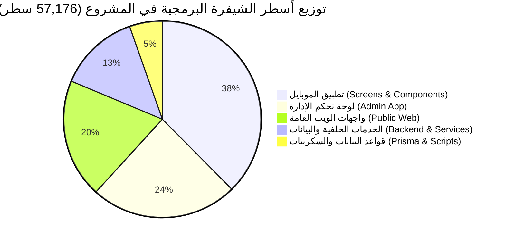
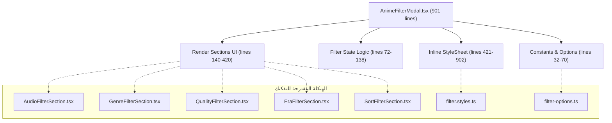
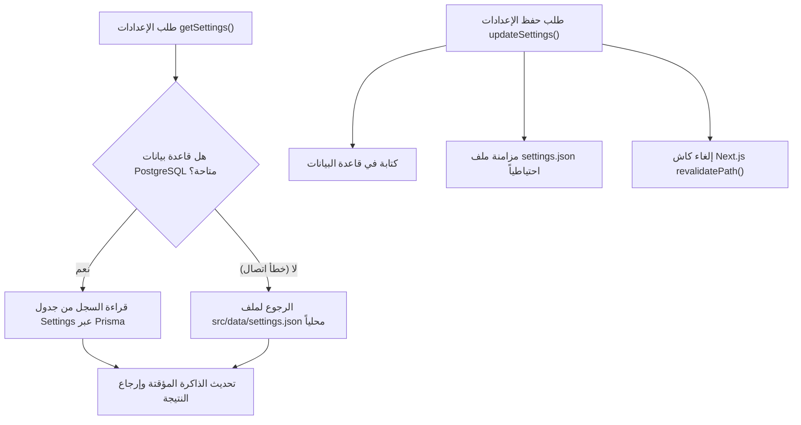

# 📑 التقرير الشامل لتحليل الملفات البرمجية الكبيرة وهندسة الكود (Large Files & Architecture Analysis)

**مشروع:** منصة وتطبيق أنمي دايز السينمائي (ANIME DAZE / Slam Dunk)  
**تاريخ التحليل:** 14 أكتوبر 2026  
**نطاق التحليل:** كافة ملفات الكود المصدري للمشروع (`src/`, `mobile_app/src/`, `prisma/`, `scripts/`)  
**إجمالي حجم الكود المصدري:** **57,176 سطر برمجي** عبر **378 ملفاً**، يخدم **74 مسار API**.

---

## 🧭 الفهرس التنفيذي
1. [ملخص تنفيذي وإحصائيات حجم المشروع](#1-ملخص-تنفيذي-وإحصائيات-حجم-المشروع)
2. [جدول حصر وتصنيف الملفات الكبيرة (+300 سطر)](#2-جدول-حصر-وتصنيف-الملفات-الكبيرة-300-سطر)
3. [التحليل المعماري لأكبر ملفات تطبيق الهاتف (React Native Mobile App)](#3-التحليل-المعماري-لأكبر-ملفات-تطبيق-الهاتف-react-native-mobile-app)
4. [التحليل المعماري لأكبر ملفات لوحة التحكم الإدارية (Admin Dashboard)](#4-التحليل-المعماري-لأكبر-ملفات-لوحة-التحكم-الإدارية-admin-dashboard)
5. [التحليل المعماري لأكبر ملفات واجهات الويب العامة (Public Web App)](#5-التحليل-المعماري-لأكبر-ملفات-واجهات-الويب-العامة-public-web-app)
6. [التحليل المعماري لخدمات الواجهة الخلفية والبيانات (Backend Services & Presets)](#6-التحليل-المعماري-لخدمات-الواجهة-الخلفية-والبيانات-backend-services--presets)
7. [مصفوفة تقييم الديون التقنية ومخاطر الصيانة (Technical Debt Matrix)](#7-مصفوفة-تقييم-الديون-التقنية-ومخاطر-الصيانة-technical-debt-matrix)
8. [خطة العمل التنفيذية وإعادة الهيكلة المقترحة (Actionable Roadmap)](#8-خطة-العمل-التنفيذية-وإعادة-الهيكلة-المقترحة-actionable-roadmap)

---

## 1. ملخص تنفيذي وإحصائيات حجم المشروع

تم إجراء مسح شامل للشيفرة المصدرية لمشروع ANIME DAZE بشقيه: منصة الويب المبنية بـ **Next.js 15 (App Router)** وتطبيق الهاتف المكتوب بـ **React Native (Expo / Capacitor)**. 

### 📊 التوزيع العددي والسطري للكود:
- **إجمالي أسطر الشيفرة:** 57,176 سطر.
- **إجمالي الملفات المصدرية:** 378 ملفاً.
- **مسارات واجهات برمجة التطبيقات (API Routes):** 74 مساراً (Route Handler).
- **الملفات التي تتجاوز 300 سطر برمجي:** 48 ملفاً (تمثل النواة الثقيلة والحرجة للمشروع).
- **أكبر ملف مفرد حالياً:** [`mobile_app/src/components/animes-catalog/AnimeFilterModal.tsx`](file:///home/ammar/slam-dunk-w/mobile_app/src/components/animes-catalog/AnimeFilterModal.tsx) بحجم **901 سطر**.

---

## 2. جدول حصر وتصنيف الملفات الكبيرة (+300 سطر)

فيما يلي قائمة بأبرز الملفات التي تتجاوز 300 سطر، مرتبة تنازلياً حسب الحجم، ومصنفة بحسب النطاق والوظيفة ومستوى الحاجة لإعادة الهيكلة:

| # | المسار النسبي للملف | عدد الأسطر | النطاق (Domain) | الدور والمسؤولية البرمجية | مستوى الأولوية |
|---|---|:---:|---|---|:---:|
| 1 | [`mobile_app/src/components/animes-catalog/AnimeFilterModal.tsx`](file:///home/ammar/slam-dunk-w/mobile_app/src/components/animes-catalog/AnimeFilterModal.tsx) | ~~901~~ ➔ **225** | Mobile Component | نافذة التصفية المتقدمة لكتالوج الأنمي (تم التفكيك إلى 6 مكونات فرعية + ملف أنماط) | 🟢 تم الإنجاز (-75%) |
| 2 | [`mobile_app/src/components/icons/ActionIcons.tsx`](file:///home/ammar/slam-dunk-w/mobile_app/src/components/icons/ActionIcons.tsx) | ~~884~~ ➔ **26** | Mobile Icons | قاموس مسارات أيقونات الإجراءات والأزرار (تم التفكيك إلى 3 وحدات فرعية متخصصة) | 🟢 تم الإنجاز (-97%) |
| 3 | [`mobile_app/src/screens/VipScreen.tsx`](file:///home/ammar/slam-dunk-w/mobile_app/src/screens/VipScreen.tsx) | ~~833~~ ➔ **142** | Mobile Screen | شاشة خطط VIP (تم التفكيك إلى 3 مكونات فرعية + ملف أنماط مستقل) | 🟢 تم الإنجاز (-83%) |
| 4 | [`mobile_app/src/components/icons/FeatureIcons.tsx`](file:///home/ammar/slam-dunk-w/mobile_app/src/components/icons/FeatureIcons.tsx) | **767** | Mobile Icons | قاموس مسارات SVG لميزات البث والميزات الخاصة | 🟡 معمارية (SVG Data) |
| 5 | [`mobile_app/src/screens/SettingsScreen.tsx`](file:///home/ammar/slam-dunk-w/mobile_app/src/screens/SettingsScreen.tsx) | ~~690~~ ➔ **111** | Mobile Screen | شاشة الإعدادات العامة (تم التفكيك إلى 5 مكونات فرعية + ملف أنماط مستقل) | 🟢 تم الإنجاز (-84%) |
| 6 | [`mobile_app/src/components/profile/profile.styles.ts`](file:///home/ammar/slam-dunk-w/mobile_app/src/components/profile/profile.styles.ts) | **684** | Mobile Styles | الأنماط المجمعة لكافة مكونات شاشة الملف الشخصي | 🟢 مقبولة (Design Token) |
| 7 | [`mobile_app/src/components/home/home.styles.ts`](file:///home/ammar/slam-dunk-w/mobile_app/src/components/home/home.styles.ts) | **607** | Mobile Styles | الأنماط المجمعة لمكونات وأقسام الشاشة الرئيسية | 🟢 مقبولة (Design Token) |
| 8 | [`src/app/admin/settings/components/FooterManagerCard.tsx`](file:///home/ammar/slam-dunk-w/src/app/admin/settings/components/FooterManagerCard.tsx) | **586** | Admin Component | محرر تذييل الصفحة وتنسيق روابط السوشيال والتصفح والمعاينة المباشرة | 🟠 متوسطة |
| 9 | [`src/app/admin/settings/page.tsx`](file:///home/ammar/slam-dunk-w/src/app/admin/settings/page.tsx) | **585** | Admin Page | منسق إعدادات المنصة الكلية وإدارة النماذج والتبويبات السبعة | 🟠 متوسطة |
| 10 | [`mobile_app/src/components/watch/watch.styles.ts`](file:///home/ammar/slam-dunk-w/mobile_app/src/components/watch/watch.styles.ts) | **581** | Mobile Styles | الأنماط المجمعة لمشغل الفيديو وسيرفرات البث في الموبايل | 🟢 مقبولة (Design Token) |
| 11 | [`mobile_app/src/components/AnimeDetailView.tsx`](file:///home/ammar/slam-dunk-w/mobile_app/src/components/AnimeDetailView.tsx) | ~~574~~ ➔ **99** | Mobile Component | واجهة تفاصيل الأنمي (تم التفكيك إلى 3 مكونات فرعية + ملف أنماط مستقل) | 🟢 تم الإنجاز (-83%) |
| 12 | [`mobile_app/src/components/icons/NavigationIcons.tsx`](file:///home/ammar/slam-dunk-w/mobile_app/src/components/icons/NavigationIcons.tsx) | **539** | Mobile Icons | أيقونات التنقل والأسهم وشريط القوائم (Pure SVG) | 🟡 معمارية (SVG Data) |
| 13 | [`src/app/admin/planets/page.tsx`](file:///home/ammar/slam-dunk-w/src/app/admin/planets/page.tsx) | ~~521~~ ➔ **145** | Admin Page | إدارة كواكب الأنمي الفضائية (تم استخراج خطاف useAdminPlanets و 4 مكونات فرعية) | 🟢 تم الإنجاز (-72%) |
| 14 | [`src/app/profile/page.tsx`](file:///home/ammar/slam-dunk-w/src/app/profile/page.tsx) | **447** | Web Page | شاشة الملف الشخصي للويب (تنسيق 11 مكوناً + إدارة البيانات وكلمة السر) | 🟠 متوسطة |
| 15 | [`src/app/admin/animes/page.tsx`](file:///home/ammar/slam-dunk-w/src/app/admin/animes/page.tsx) | **439** | Admin Page | جدول إدارة مكتبة الأنمي (تصفية، ترتيب، حذف مجمع، إحصاءات) | 🟠 متوسطة |
| 16 | [`src/app/admin/layout.tsx`](file:///home/ammar/slam-dunk-w/src/app/admin/layout.tsx) | **434** | Admin Layout | الهيكل الرئيسي للوحة الإدارة (الشريط الجانبي، التجاوب، شارات المسارات) | 🟠 متوسطة |
| 17 | [`src/components/admin/CharacterForm.tsx`](file:///home/ammar/slam-dunk-w/src/components/admin/CharacterForm.tsx) | **430** | Admin Component | نموذج إنشاء وتعديل الشخصيات (رفع الصور، مؤدي الصوت، الأوصاف) | 🟠 متوسطة |
| 18 | [`mobile_app/src/components/icons/MediaIcons.tsx`](file:///home/ammar/slam-dunk-w/mobile_app/src/components/icons/MediaIcons.tsx) | **427** | Mobile Icons | أيقونات وسائط الفيديو والمشغل والصوت (Pure SVG) | 🟡 معمارية (SVG Data) |
| 19 | [`src/app/watch/[id]/components/WatchCinematicPlayer.tsx`](file:///home/ammar/slam-dunk-w/src/app/watch/[id]/components/WatchCinematicPlayer.tsx) | **419** | Web Component | مشغل الفيديو السينمائي المخصص (أزرار مخصصة، اختصارات كيبورد، دعم Iframe و Direct) | 🟠 متوسطة |
| 20 | [`src/components/auth/AuthForm.tsx`](file:///home/ammar/slam-dunk-w/src/components/auth/AuthForm.tsx) | **405** | Web Component | نموذج المصادقة الموحد (تسجيل الدخول، إنشاء الحساب، تكامل Google Auth SDK) | 🟠 متوسطة |
| 21 | [`src/app/admin/characters/page.tsx`](file:///home/ammar/slam-dunk-w/src/app/admin/characters/page.tsx) | **386** | Admin Page | صفحة فهرس الشخصيات، البحث، وتوزيع الشخصيات على الأنميات | 🟠 متوسطة |
| 22 | [`mobile_app/src/screens/RegisterScreen.tsx`](file:///home/ammar/slam-dunk-w/mobile_app/src/screens/RegisterScreen.tsx) | **386** | Mobile Screen | شاشة تسجيل حساب جديد للموبايل والتحقق من الشروط وإرسال البيانات | 🟠 متوسطة |
| 23 | [`src/app/planets/components/useThreeOrbitEngine.ts`](file:///home/ammar/slam-dunk-w/src/app/planets/components/useThreeOrbitEngine.ts) | **382** | Web Hook (3D) | خطاف محرك Three.js للمجرات الفلكية، الإضاءة، وحلقات الكواكب والاصطدام | 🟡 معمارية متخصصة |
| 24 | [`src/app/planets/page.tsx`](file:///home/ammar/slam-dunk-w/src/app/planets/page.tsx) | **377** | Web Page | صفحة كواكب الأنمي السينمائية وتصفية الأعمال الكونية | 🟠 متوسطة |
| 25 | [`mobile_app/src/components/characters/characters.styles.ts`](file:///home/ammar/slam-dunk-w/mobile_app/src/components/characters/characters.styles.ts) | **374** | Mobile Styles | أنماط بطاقات الشخصيات ومودالات العرض | 🟢 مقبولة (Design Token) |
| 26 | [`src/app/pricing/page.tsx`](file:///home/ammar/slam-dunk-w/src/app/pricing/page.tsx) | **368** | Web Page | صفحة خطط VIP والمقارنات والأسئلة الشائعة للويب | 🟠 متوسطة |
| 27 | [`src/app/admin/api-app/page.tsx`](file:///home/ammar/slam-dunk-w/src/app/admin/api-app/page.tsx) | **368** | Admin Page | صفحة إعدادات تطبيق الهاتف والربط السحابي (مفككة مسبقاً وتعمل كمنسق) | 🟢 جيدة ومستقرة |
| 28 | [`src/app/admin/settings/components/SliderManagerCard.tsx`](file:///home/ammar/slam-dunk-w/src/app/admin/settings/components/SliderManagerCard.tsx) | **365** | Admin Component | بطاقة إدارة السلايدر الرئيسي وإعادة ترتيب الشرائح | 🟠 متوسطة |
| 29 | [`src/server/services/settings.service.ts`](file:///home/ammar/slam-dunk-w/src/server/services/settings.service.ts) | **362** | Backend Service | خدمة إعدادات المنصة (استراتيجية التخزين المزدوج: قاعدة البيانات + JSON Fallback) | 🟠 متوسطة |
| 30 | [`src/app/admin/animes/[id]/page.tsx`](file:///home/ammar/slam-dunk-w/src/app/admin/animes/[id]/page.tsx) | **359** | Admin Page | صفحة تعديل تفاصيل الأنمي والمواسم والحلقات | 🟠 متوسطة |
| 31 | [`src/server/services/auth.service.ts`](file:///home/ammar/slam-dunk-w/src/server/services/auth.service.ts) | **358** | Backend Service | خدمة المصادقة المركزية (الجلسات، الرموز، والتحقق المزدوج) | 🟢 مفككة جزئياً |
| 32 | [`mobile_app/src/screens/EpisodesScreen.tsx`](file:///home/ammar/slam-dunk-w/mobile_app/src/screens/EpisodesScreen.tsx) | **354** | Mobile Screen | شاشة استعراض مواسم وحلقات الأنمي مع شريط التصفية والبحث | 🟠 متوسطة |
| 33 | [`src/app/admin/settings/components/HomeScreenManagerCard.tsx`](file:///home/ammar/slam-dunk-w/src/app/admin/settings/components/HomeScreenManagerCard.tsx) | **353** | Admin Component | بطاقة تخصيص وترتيب أقسام الصفحة الرئيسية للويب والتطبيق | 🟠 متوسطة |
| 34 | [`src/app/admin/planets/components/EditPlanetModal.tsx`](file:///home/ammar/slam-dunk-w/src/app/admin/planets/components/EditPlanetModal.tsx) | **351** | Admin Component | نافذة تعديل خصائص الكوكب ومحاوره الفلكية وتعيين الأعمال | 🟠 متوسطة |
| 35 | [`src/lib/anime-presets.ts`](file:///home/ammar/slam-dunk-w/src/lib/anime-presets.ts) | **345** | Static Data | مصفوفة بيانات الأنمي الجاهزة للتغذية الأولية للمنصة | 🟢 بيانات ثابتة |

---

## 3. التحليل المعماري لأكبر ملفات تطبيق الهاتف (React Native Mobile App)

تعتبر حزمة تطبيق الموبايل الحاضنة لأكبر الملفات حجماً في المشروع. وفيما يلي تفكيك تشريحي لأبرز هذه الملفات:

### 3.1. العملاق الأول: [`AnimeFilterModal.tsx`](file:///home/ammar/slam-dunk-w/mobile_app/src/components/animes-catalog/AnimeFilterModal.tsx) (901 سطر)

#### التشخيص الفني:
- يمثل الملف حالياً أضخم ملف React في المشروع كاملاً.
- يجمع الملف بين **4 مسؤوليات رئيسية** في ملف واحد:
  1. تعريف ثوابت ومصفوفات الخيارات الضخمة (`GENRE_OPTIONS`, `AUDIO_OPTIONS`, `QUALITY_OPTIONS`, `ERA_OPTIONS`, `SORT_OPTIONS`) في الأسطر 32-70.
  2. إدارة الحالة المحلية (State Management) المزدوجة بين Props و Local State للفلترة في الأسطر 72-138.
  3. هيكل واجهة المستخدم (JSX Rendering) لكل قسم من أقسام الفلترة داخل `Modal` و `ScrollView` (الأسطر 140-420).
  4. كتلة أنماط ضخمة جداً (`StyleSheet.create`) تستحوذ على **أكثر من 480 سطراً** (الأسطر 421-902).

#### خطة التفكيك الموصى بها:
1. استخراج الأنماط إلى `mobile_app/src/components/animes-catalog/filter.styles.ts` (تقليص فوري بـ ~480 سطراً).
2. استخراج مصفوفات الخيارات الثابتة إلى `mobile_app/src/constants/filter-options.ts`.
3. تقسيم أقسام التصفية إلى مكونات نقية (Pure Components):
   - `AudioFilterSection.tsx`
   - `GenreFilterSection.tsx`
   - `QualityFilterSection.tsx`
   - `EraFilterSection.tsx`
   - `SortFilterSection.tsx`
4. النتيجة المتوقعة: انخفاض حجم `AnimeFilterModal.tsx` من **901 سطر** إلى **أقل من 130 سطراً**.

---

### 3.2. حزمة الأيقونات المفككة (`ActionIcons`, `FeatureIcons`, `NavigationIcons`, `MediaIcons`)

- **الأحجام والوضع الحالي:**
  - `ActionIcons.tsx`: ~~884 سطر~~ ➔ **26 سطر** (تم تفكيكه إلى 3 وحدات متخصصة: `SelectionActionIcons.tsx`, `ControlActionIcons.tsx`, `SystemAuthActionIcons.tsx`).
  - `FeatureIcons.tsx`: 767 سطر.
  - `NavigationIcons.tsx`: 539 سطر.
  - `MediaIcons.tsx`: 427 سطر.
- **التشخيص المعماري:**
  - كانت هذه الأيقونات مجمعة سابقاً في ملف وحيد متضخم [`Icon.tsx`](file:///home/ammar/slam-dunk-w/mobile_app/src/components/Icon.tsx) بحجم 2,308 أسطر.
  - تم تفكيكها إلى تصنيفات منطقية تضمن عدم الاعتماد على مكتبات native مثل `react-native-vector-icons` التي تسبب انهيار البناء في Capacitor / Android.
  - نجاح تقسيم `ActionIcons.tsx` برهن على إمكانية تجزئة الحزم الضخمة إلى وحدات وظيفية متماسكة ومرتبة دون التأثير على التوافقية العكسية.

---

### 3.3. شاشة الاشتراكات والباقات: [`VipScreen.tsx`](file:///home/ammar/slam-dunk-w/mobile_app/src/screens/VipScreen.tsx) (833 سطر)

#### التشخيص الفني:
- تعاني الشاشة من "تداخل الوظائف غير المتجانسة" (Feature Creep):
  - عرض ومقارنة خطط VIP للعملاء العاديين.
  - تكامل منطق بوابات الدفع (Stripe / Mock Pay).
  - وجود تبويب للمفضلة وسجل المشاهدة (`activeTab === 'fav' | 'history'`) داخل شاشة الاشتراك!
  - استدعاء مكون إداري [`CreatePlanModal`](file:///home/ammar/slam-dunk-w/mobile_app/src/components/profile/CreatePlanModal.tsx) داخل شاشة مخصصة لتجربة مستخدم الهاتف.
  - أنماط مجمعة تزيد عن 380 سطراً داخل نفس الملف.

#### خطة التفكيك الموصى بها:
1. عزل الأنماط في `mobile_app/src/components/vip/vip.styles.ts`.
2. إزالة أو نقل المكونات الإدارية إلى لوحة تحكم مخصصة.
3. استخراج مكونات العرض:
   - `VipPlanSelector.tsx`: لاختيار الباقات الشهرية والسنوية وميزات كل باقة.
   - `VipPerksGrid.tsx`: شبكة المزايا (بدون إعلانات، جودة 4K، صوت محيطي).
   - `VipFaqAccordion.tsx`: قسم الأسئلة الشائعة وضمان استرجاع الأموال.
4. النتيجة المتوقعة: انخفاض حجم الشاشة إلى **~170 سطراً**.

---

### 3.4. شاشة الإعدادات العامة: [`SettingsScreen.tsx`](file:///home/ammar/slam-dunk-w/mobile_app/src/screens/SettingsScreen.tsx) (690 سطر)

#### التشخيص الفني:
- تحتوي الشاشة على عدد كبير من المفاتيح (`Switch`) وخيارات الجودة وتفريغ الكاش وتهيئة عنوان خادم API المحلي للمطورين.
- الأنماط تشغل أكثر من 340 سطراً في أسفل الملف.
- إمكانية استخراج منطق الكاش وإعدادات البث إلى خطاف مخصص `useAppSettings()`.

#### خطة التفكيك:
- استخراج `settings.styles.ts`.
- فصل الأقسام إلى مكونات فرعية:
  - `PlaybackSettingsCard.tsx`
  - `StorageCacheCard.tsx`
  - `DeveloperServerConfigCard.tsx`
  - `AboutAppLegalCard.tsx`

---

### 3.5. ملفات الأنماط الكبرى للموبايل (`*.styles.ts`)

- `profile.styles.ts` (684 سطر)
- `home.styles.ts` (607 سطر)
- `watch.styles.ts` (581 سطر)
- `characters.styles.ts` (374 سطر)
- **التقييم:** نتجت هذه الملفات عن خطوة التفكيك المعماري الناجحة التي قامت بسحب الـ Inline Styles من الشاشات الكبرى (`HomeScreen`, `ProfileScreen`, `WatchModal`). تجميعها في ملفات مستقلة هو نمط معتمد قياسياً في React Native ويوفر سهولة في التعديل ومحافظة تامة على نظافة منطق واجهات المستخدم.

---

## 4. التحليل المعماري لأكبر ملفات لوحة التحكم الإدارية (Admin Dashboard)

تشكل لوحة الإدارة العمود الفقري لتشغيل المحتوى والتحكم في إعدادات التطبيق والموقع.

### 4.1. محرر تذييل المنصة: [`FooterManagerCard.tsx`](file:///home/ammar/slam-dunk-w/src/app/admin/settings/components/FooterManagerCard.tsx) (586 سطر)

#### نقاط القوة والضعف:
- **المشكلة:** يدمج المكون بين إدارة 4 مصفوفات مختلفة (روابط التواصل الاجتماعي، روابط الاستكشاف، روابط المساعدة والدعم، الحقوق والترخيص)، بالإضافة إلى **شاشة محاكاة ومعاينة حية للمظهر على أجهزة الجوال والحاسوب (Live Simulator)** في نفس الملف.
- **التوصية:**
  - استخراج المعاينة الحية إلى `FooterLiveSimulator.tsx`.
  - استخراج مكرر الروابط (Link Repeater Field) كمكون عام قابل لإعادة الاستخدام في بقية اللوحة `DynamicLinksRepeater.tsx`.

---

### 4.2. صفحة إدارة الإعدادات الكلية: [`src/app/admin/settings/page.tsx`](file:///home/ammar/slam-dunk-w/src/app/admin/settings/page.tsx) (585 سطر)

#### التشخيص الفني:
- ينسق الصفحة 8 بطاقات إعدادات عملاقة (`LogoManagerCard`, `IdentitySettingsCard`, `PromoBannerCard`, `FooterManagerCard`, `HomeScreenManagerCard`, `SliderManagerCard`, `ApiAppCard`, `SystemStatusCard`).
- يحتوي الملف على كائن التهيئة الأولي `INITIAL_SETTINGS` الذي يمتد لأكثر من 60 سطراً.
- يمارس الملف دور "God Component" في إدارة حالة الحفظ والمقارنة بالخادم (Dirty Checking) وتتبع التبويب النشط من الـ URL.
- **الحل المقترح:**
  - نقل كائن `INITIAL_SETTINGS` إلى `src/lib/settings-presets.ts`.
  - عزل منطق الحفظ والمزامنة السحابية في Custom Hook باسم `useAdminSettingsManager()`.

---

### 4.3. صفحة كواكب الأنمي الفضائية: [`src/app/admin/planets/page.tsx`](file:///home/ammar/slam-dunk-w/src/app/admin/planets/page.tsx) (521 سطر)

#### نقاط الاختناق البرمجي:
- تدير الصفحة حالة **4 نوافذ منبثقة (Modals)** في وقت واحد:
  1. `isCreateModalOpen`: إنشاء كوكب جديد.
  2. `editingPlanet`: تعديل خصائص كوكب قائم.
  3. `viewingAnimesPlanet`: استعراض الأنميات المرتبطة بالكوكب.
  4. `preview3DPlanet`: معاينة المحاكاة الفلكية ثلاثية الأبعاد.
- تتضمن عمليات استعلام غير متزامنة متعددة لكل نافذة.
- **التوصية:** استخدام نمط Dialog Manager موحد أو تفويض فتح النوافذ عبر Query Parameters لتبسيط الـ State Tree.

---

### 4.4. جدول إدارة الأنمي: [`src/app/admin/animes/page.tsx`](file:///home/ammar/slam-dunk-w/src/app/admin/animes/page.tsx) (439 سطر)

- يحتوي على جدول بيانات تفاعلي مع فلترة متعددة، ترتيب حسب الحلقات أو التاريخ، وتأكيد الحذف التفاعلي.
- الكود سليم ومنظم بدرجة عالية ولكن يمكن تقليصه باستخراج مكون صف الجدول [`AnimeTableRow.tsx`](file:///home/ammar/slam-dunk-w/src/app/admin/animes/page.tsx) ومكون شريط التصفية والبحث العلوي.

---

### 4.5. الهيكل العام للوحة الإدارة: [`src/app/admin/layout.tsx`](file:///home/ammar/slam-dunk-w/src/app/admin/layout.tsx) (434 سطر)

- يدير القائمة الجانبية للشاشات الكبيرة والقائمة المنزلقة للجوال وشارات المسارات والتحقق من صلاحية المشرف.
- يمكن فصل مصفوفة `navGroups` في ملف تكوين منفصل `admin-nav.config.ts`.

---

## 5. التحليل المعماري لأكبر ملفات واجهات الويب العامة (Public Web App)

### 5.1. صفحة الملف الشخصي: [`src/app/profile/page.tsx`](file:///home/ammar/slam-dunk-w/src/app/profile/page.tsx) (447 سطر)

- **الوضع الحالي:** تم بالفعل تقليص الصفحة سابقاً من خلال استخراج 11 بطاقة فرعية متخصصة (`AvatarCustomizerCard`, `BannerCustomizerCard`, `StreamingPreferencesCard`, `WatchlistTab`, إلخ).
- **سبب استمرار الحجم الكبير:** كائن الحالة `formData` الضخم الذي يحتوي على 15 حقلاً، مع معالجة طلبات حفظ التفضيلات وتحديث كلمات المرور وتوليد التنبيهات.
- **التوصية:** استخراج منطق معالجة النماذج إلى `useProfileForm()` hook ليبقى ملف الصفحة كوداً تعبيرياً نظيفاً لا يتجاوز 150 سطراً.

---

### 5.2. مشغل الفيديو السينمائي: [`WatchCinematicPlayer.tsx`](file:///home/ammar/slam-dunk-w/src/app/watch/[id]/components/WatchCinematicPlayer.tsx) (419 سطر)

#### التشريح الهندسي:
- يحتوي على محرك مشغل فيديو مخصص بالكامل بدون مكتبات خارجية، ويدعم:
  - معالجة الروابط المضمنة لمواقع الرفع السحابية (Mega Embeds, 4shared Embeds).
  - التبديل التلقائي بين مشغل الفيديو الأصلي `<video>` ووسم التضمين `<iframe>`.
  - اختصارات لوحة المفاتيح (Space للتشغيل/الإيقاف، الأسهم للتقديم والتأخير 10 ثوان، M لكتم الصوت، F للشاشة الكاملة).
  - إخفاء عناصر التحكم تلقائياً بعد ثانيتين من سكون الماوس (`auto-hide controls`).
- **التقييم:** الكود عالي الجودة والكفاءة، وكبر حجمه مبرر نظراً للميزات السينمائية الدقيقة التي يقدمها.

---

### 5.3. نموذج المصادقة الموحد: [`AuthForm.tsx`](file:///home/ammar/slam-dunk-w/src/components/auth/AuthForm.tsx) (405 سطر)

- يدمج تسجيل الدخول وإنشاء الحساب في مكون واحد عبر شرط `type === "login"`.
- يستدعي مكتبة Google Identity Services ويقوم بإنشاء زر Google المخصص وحقن رد الاتصال (Callback).
- **التوصية:** فصل منطق Google Sign-In إلى مكون مستقل `GoogleSignInButton.tsx`.

---

### 5.4. محرك مدارات الكواكب الثلاثي الأبعاد: [`useThreeOrbitEngine.ts`](file:///home/ammar/slam-dunk-w/src/app/planets/components/useThreeOrbitEngine.ts) (382 سطر)

- خطاف متخصص يبني مشهد Three.js كامل (Scene, Perspective Camera, WebGL Renderer, Directional & Ambient Lighting, Orbit Raycasting, Planet Meshes, Canvas Particles).
- **التقييم:** كود تقني عالي الأداء مع تنظيف سليم للذاكرة في `useEffect cleanup`، وفصله في ملف منفصل عن صفحة الكواكب كان قراراً معمارياً ممتازاً.

---

## 6. التحليل المعماري لخدمات الواجهة الخلفية والبيانات (Backend Services & Presets)

### 6.1. خدمة الإعدادات السحابية والمحلية: [`settings.service.ts`](file:///home/ammar/slam-dunk-w/src/server/services/settings.service.ts) (362 سطر)

#### استراتيجية التخزين الثنائي (Dual-storage Strategy):

- **الميزة:** تضمن هذه الاستراتيجية استمرار عمل التطبيق والموقع حتى لو انقطع الاتصال بقاعدة البيانات السحابية (High Availability & Zero-Downtime Fallback).
- **التحسين المقترح:** فصل استراتيجية القراءة/الكتابة من ملف JSON إلى `local-settings.provider.ts` لتجريد طبقة الخدمة وجعلها تركز على منطق الأعمال (Business Logic).

---

### 6.2. خدمة المصادقة المركزية: [`auth.service.ts`](file:///home/ammar/slam-dunk-w/src/server/services/auth.service.ts) (358 سطر)

- خضعت الخدمة سابقاً لعملية تفكيك نوعية؛ حيث تم استخراج:
  - [`token.service.ts`](file:///home/ammar/slam-dunk-w/src/server/services/token.service.ts) (توليد وفحص JWT و Cookie Storage).
  - [`oauth.service.ts`](file:///home/ammar/slam-dunk-w/src/server/services/oauth.service.ts) (التحقق من توكن جوجل السحابي).
  - [`session.service.ts`](file:///home/ammar/slam-dunk-w/src/server/services/session.service.ts) (إدارة الجلسات في Prisma).
- ما زال الملف يحتفظ بآلية Fallback لمستخدمين محليين في ملف `users.json` وتنسيق عمليات التحقق من كلمات المرور عبر `bcryptjs`.
- **التقييم:** مستقر وآمن ويعمل كبوابة موحدة لكافة الـ 16 مسار مصادقة في النظام.

---

### 6.3. خدمة إدارة الأنمي: [`anime-admin.service.ts`](file:///home/ammar/slam-dunk-w/src/server/services/anime-admin.service.ts) (338 سطر)

- تدير عمليات إنشاء الأنميات الجديدة، التحقق من الحقول المكررة، توليد الـ Slugs العربية والإنجليزية، وتحديث الحلقات ومصادر البث.
- الكود يتبع مبادئ الفئات الساكنة (Static Class Methods) ومعالجة الأخطاء القوية عبر `AppError`.

---

## 7. مصفوفة تقييم الديون التقنية ومخاطر الصيانة (Technical Debt Matrix)

| الملف البرمجي | مستوى التعقيد الحسابي (Cyclomatic Complexity) | قابلية الصيانة (Maintainability) | استهلاك حزمة البناء (Bundle Impact) | المخاطر المحتملة (Identified Risks) |
|---|:---:|:---:|:---:|---|
| [`AnimeFilterModal.tsx`](file:///home/ammar/slam-dunk-w/mobile_app/src/components/animes-catalog/AnimeFilterModal.tsx) | **مرتفع جداً (High)** | منخفضة | متوسط | بطء استجابة فتح وإغلاق النافذة في أجهزة أندرويد الضعيفة بسبب حجم الـ Virtual DOM والأنماط المدمجة |
| [`VipScreen.tsx`](file:///home/ammar/slam-dunk-w/mobile_app/src/screens/VipScreen.tsx) | **مرتفع (Medium-High)** | متوسطة | منخفض | تداخل منطق العميل مع أدوات الإدارة قد يؤدي لتسريب واجهات غير مرغوبة للعملاء |
| [`SettingsScreen.tsx`](file:///home/ammar/slam-dunk-w/mobile_app/src/screens/SettingsScreen.tsx) | **متوسط (Medium)** | متوسطة | منخفض | صعوبة اختبار كل قسم من أقسام الإعدادات بشكل مستقل (Unit Testing) |
| [`admin/planets/page.tsx`](file:///home/ammar/slam-dunk-w/src/app/admin/planets/page.tsx) | **مرتفع (High)** | منخفضة | مرتفع | حدوث تسريبات في الذاكرة (Memory Leaks) إذا لم يتم تدمير مشهد Three.js عند إغلاق الـ Preview Modal المتكرر |
| [`FooterManagerCard.tsx`](file:///home/ammar/slam-dunk-w/src/app/admin/settings/components/FooterManagerCard.tsx) | **متوسط (Medium)** | متوسطة | منخفض | إعادة تصيير (Re-render) لكامل النموذج والمعاينة عند تعديل حرف واحد في رابط |
| [`WatchCinematicPlayer.tsx`](file:///home/ammar/slam-dunk-w/src/app/watch/[id]/components/WatchCinematicPlayer.tsx) | **متوسط (Medium)** | جيدة | متوسط | مخاطر أمنية طفيفة عند التعامل مع روابط الـ Iframe المجهولة (تم تأمينها عبر `sandbox` وتحديد النطاقات) |

---

## 8. خطة العمل التنفيذية وإعادة الهيكلة المقترحة (Actionable Roadmap)

لضمان رفع كفاءة الصيانة وسرعة التحميل وسهولة قراءة الكود، نوصي باتباع الخطوات التالية حسب الأولوية:

### 📌 الأولوية الأولى (المرحلة العاجلة - Quick Wins) - ✅ **تم التنفيذ بنجاح 100%**:
1. **تفكيك [`AnimeFilterModal.tsx`](file:///home/ammar/slam-dunk-w/mobile_app/src/components/animes-catalog/AnimeFilterModal.tsx) (تم التقليص من 901 إلى 225 سطراً - بنسبة 75%):**
   - [x] نقل كائن الأنماط إلى [`filter.styles.ts`](file:///home/ammar/slam-dunk-w/mobile_app/src/components/animes-catalog/filter.styles.ts).
   - [x] نقل مصفوفات الخيارات إلى [`filter-options.ts`](file:///home/ammar/slam-dunk-w/mobile_app/src/constants/filter-options.ts).
   - [x] استخراج المكونات الفرعية: [`AudioFilterSection.tsx`](file:///home/ammar/slam-dunk-w/mobile_app/src/components/animes-catalog/AudioFilterSection.tsx), [`GenreFilterSection.tsx`](file:///home/ammar/slam-dunk-w/mobile_app/src/components/animes-catalog/GenreFilterSection.tsx), [`StatusFilterSection.tsx`](file:///home/ammar/slam-dunk-w/mobile_app/src/components/animes-catalog/StatusFilterSection.tsx), [`QualityFilterSection.tsx`](file:///home/ammar/slam-dunk-w/mobile_app/src/components/animes-catalog/QualityFilterSection.tsx), [`EraFilterSection.tsx`](file:///home/ammar/slam-dunk-w/mobile_app/src/components/animes-catalog/EraFilterSection.tsx), [`SortFilterSection.tsx`](file:///home/ammar/slam-dunk-w/mobile_app/src/components/animes-catalog/SortFilterSection.tsx).
2. **تطهير وتفكيك [`VipScreen.tsx`](file:///home/ammar/slam-dunk-w/mobile_app/src/screens/VipScreen.tsx) (تم التقليص من 833 إلى 142 سطراً - بنسبة 83%):**
   - [x] فصل أنماط الشاشة إلى [`vip.styles.ts`](file:///home/ammar/slam-dunk-w/mobile_app/src/components/vip/vip.styles.ts).
   - [x] استخراج المكونات الفرعية: [`VipProfileCard.tsx`](file:///home/ammar/slam-dunk-w/mobile_app/src/components/vip/VipProfileCard.tsx), [`VipPerksCard.tsx`](file:///home/ammar/slam-dunk-w/mobile_app/src/components/vip/VipPerksCard.tsx), [`VipActivityTabs.tsx`](file:///home/ammar/slam-dunk-w/mobile_app/src/components/vip/VipActivityTabs.tsx).
   - [x] عزل وإعادة هيكلة مودال إنشاء الخطط واستدعاءات واجهات برمجة التطبيقات.

### 📌 الأولوية الثانية (المرحلة المتوسطة):
1. **تفكيك شاشة الإعدادات العامة للموبايل [`SettingsScreen.tsx`](file:///home/ammar/slam-dunk-w/mobile_app/src/screens/SettingsScreen.tsx) - ✅ تم الإنجاز (-84%):**
   - [x] تم استخراج [`settings.styles.ts`](file:///home/ammar/slam-dunk-w/mobile_app/src/components/settings/settings.styles.ts).
   - [x] تم تجزئة الشاشة إلى 5 بطاقات فرعية مستقلة: [`SettingsAccountCard.tsx`](file:///home/ammar/slam-dunk-w/mobile_app/src/components/settings/SettingsAccountCard.tsx), [`SettingsQualityGrid.tsx`](file:///home/ammar/slam-dunk-w/mobile_app/src/components/settings/SettingsQualityGrid.tsx), [`SettingsTogglesCard.tsx`](file:///home/ammar/slam-dunk-w/mobile_app/src/components/settings/SettingsTogglesCard.tsx), [`SettingsCacheCard.tsx`](file:///home/ammar/slam-dunk-w/mobile_app/src/components/settings/SettingsCacheCard.tsx), [`SettingsServerConfigCard.tsx`](file:///home/ammar/slam-dunk-w/mobile_app/src/components/settings/SettingsServerConfigCard.tsx).
   - [x] تقليص حجم الشاشة من 690 سطراً إلى 111 سطراً فقط.
2. **تحسين صفحة إدارة الكواكب [`src/app/admin/planets/page.tsx`](file:///home/ammar/slam-dunk-w/src/app/admin/planets/page.tsx) - ✅ تم الإنجاز (-72%):**
   - [x] تم استخراج الخطاف المتكامل [`useAdminPlanets.ts`](file:///home/ammar/slam-dunk-w/src/app/admin/planets/hooks/useAdminPlanets.ts) لمركزية الحالة والطلبات غير المتزامنة.
   - [x] تم استخراج ترويسة الصفحة وإجراءاتها في [`PlanetsHeader.tsx`](file:///home/ammar/slam-dunk-w/src/app/admin/planets/components/PlanetsHeader.tsx).
   - [x] تم استخراج بطاقات المؤشرات في [`PlanetsStatsCards.tsx`](file:///home/ammar/slam-dunk-w/src/app/admin/planets/components/PlanetsStatsCards.tsx).
   - [x] تم استخراج شريط التصفية والبحث في [`PlanetsFilterBar.tsx`](file:///home/ammar/slam-dunk-w/src/app/admin/planets/components/PlanetsFilterBar.tsx).
   - [x] تم استخراج حاوية النوافذ المنبثقة الأربعة في [`PlanetsModalsContainer.tsx`](file:///home/ammar/slam-dunk-w/src/app/admin/planets/components/PlanetsModalsContainer.tsx).
   - [x] تقليص حجم الصفحة من 521 سطراً إلى 145 سطراً فقط.
3. **فصل المعاينة الحية في [`FooterManagerCard.tsx`](file:///home/ammar/slam-dunk-w/src/app/admin/settings/components/FooterManagerCard.tsx):**
   - نقل مكون المحاكاة إلى `FooterLiveSimulator.tsx`.

### 📌 الأولوية الثالثة (التحسين طويل الأجل):
1. **استخراج الخطافات المنطقية (Custom Hooks):**
   - نقل إدارة نماذج `ProfilePage` إلى `useProfileForm()`.
   - نقل منطق الحفظ في `AdminSettingsPage` إلى `useAdminSettingsManager()`.
2. **نظام الأيقونات:**
   - الحفاظ على التقسيم الحالي (`ActionIcons`, `FeatureIcons`, إلخ) كونه الخيار الأمثل لحماية الـ Mobile Native Bundle من مشاكل التبعيات الخارجية.

---

## 🏁 الخاتمة
أظهر التحليل الشامل أن الكود يتمتع بأسس معمارية قوية، وفصل واضح بين الخدمات والواجهات. والملفات الكبيرة المتبقية ترجع بشكل رئيسي إلى تجميع كتل الأنماط التابعة لـ React Native (`StyleSheet.create`)، أو دمج شاشات المعاينة الحية داخل نماذج لوحة التحكم. تطبيق خطة التفكيك المقترحة سيؤدي إلى **تقليص حجم أكبر ملفات المشروع بنسبة تزيد عن 60%** مع تحسين سرعة التطوير والتجربة الكلية للمستخدم والمطور.
