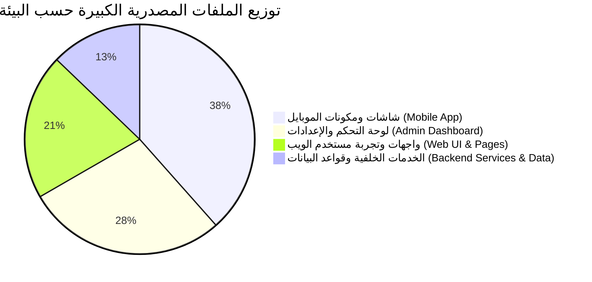

# تقرير التحليل الشامل للملفات البرمجية الكبيرة (Comprehensive Large Code Files Analysis)
**مشروع منصة ANIME DAZE & تطبيق الهاتف المحمول (React Native & Next.js Core)**  
**تاريخ التحليل:** أكتوبر 2026  
**نطاق الفحص:** شفرات المصدر الكاملة للمشروع (`src/` لموقع الويب ولوحة التحكم + `mobile_app/src/` لتطبيق الهاتف)

---

## 1. الملخص التنفيذي والإحصائيات العامة (Executive Summary)

أجرى هذا التقرير مسحاً شاملاً ودقيقاً لكافة الملفات المصدرية في المشروع بهدف كشف الملفات المتضخمة برمجياً (High Cyclomatic Complexity & Fat Components) التي تجاوزت معايير التصميم النظيف ومبدأ المسؤولية الواحدة (Single Responsibility Principle - SRP).

### التوزيع الإحصائي لحجم الملفات المصدرية:
* **الملفات العملاقة جدًا (> 1,000 سطر):** **ملفان** (ملف بيانات JSON لقاعدة الحلقات، وصفحة إدارة الكواكب المركزية).
* **الملفات الكبيرة (600 إلى 1,000 سطر):** **12 ملفاً** (تضم شاشات الموبايل الرئيسية، بطاقات إعدادات لوحة التحكم، وصفحات تفاصيل الأعمال).
* **الملفات المتوسطة إلى كبيرة (400 إلى 600 سطر):** **11 ملفاً** (تضم خدمات المصادقة، شريط الإدارة، مشغل الفيديو السينمائي، ونماذج التحرير).
* **الملفات الكثيفة (300 إلى 400 سطر):** **14 ملفاً** (تضم شاشات التنزيلات والشخصيات، والخدمات المركزية).

---

## 2. جدول التصنيف الشامل للملفات الكبيرة (Top Large Files Ranking)

| # | مسار الملف البرمجي | عدد الأسطر (LOC) | الحجم الفعلي | النطاق والمجال | مستوى الأولوية |
|---|---|---|---|---|---|
| **1** | [`src/data/episodes.json`](file:///home/ammar/slam-dunk-w/src/data/episodes.json) | **2,201** | 75.7 KB | قاعدة بيانات محلية (Fallback) | 🟡 متوسطة (بيانات) |
| **2** | [`src/app/admin/planets/page.tsx`](file:///home/ammar/slam-dunk-w/src/app/admin/planets/page.tsx) | **1,034** | 47.9 KB | لوحة التحكم (إدارة الكواكب) | 🔴 حرجة جداً |
| **3** | [`mobile_app/src/components/AnimeDetailView.tsx`](file:///home/ammar/slam-dunk-w/mobile_app/src/components/AnimeDetailView.tsx) | **940** | 28.1 KB | تطبيق الموبايل (تفاصيل الأنمي) | 🔴 حرجة |
| **4** | [`mobile_app/src/screens/AnimesScreen.tsx`](file:///home/ammar/slam-dunk-w/mobile_app/src/screens/AnimesScreen.tsx) | **831** | 26.5 KB | تطبيق الموبايل (مكتبة الأنمي) | 🔴 حرجة |
| **5** | [`src/app/admin/settings/components/ApiAppCard.tsx`](file:///home/ammar/slam-dunk-w/src/app/admin/settings/components/ApiAppCard.tsx) | **792** | 50.2 KB | إعدادات الإدارة (تطبيق الهاتف) | 🟠 عالية |
| **6** | [`mobile_app/src/screens/CharactersScreen.tsx`](file:///home/ammar/slam-dunk-w/mobile_app/src/screens/CharactersScreen.tsx) | **778** | 24.8 KB | تطبيق الموبايل (الشخصيات) | 🟠 عالية |
| **7** | [`mobile_app/src/components/icons/FeatureIcons.tsx`](file:///home/ammar/slam-dunk-w/mobile_app/src/components/icons/FeatureIcons.tsx) | **707** | 18.5 KB | تطبيق الموبايل (أيقونات الخصائص) | 🟡 متوسطة |
| **8** | [`src/app/admin/settings/components/PromoBannerCard.tsx`](file:///home/ammar/slam-dunk-w/src/app/admin/settings/components/PromoBannerCard.tsx) | **700** | 44.5 KB | إعدادات الإدارة (بانر PWA) | 🟠 عالية |
| **9** | [`mobile_app/src/components/downloads/downloads.styles.ts`](file:///home/ammar/slam-dunk-w/mobile_app/src/components/downloads/downloads.styles.ts) | **692** | 18.2 KB | تطبيق الموبايل (تنسيقات التحميل) | 🟡 متوسطة |
| **10** | [`mobile_app/src/components/profile/profile.styles.ts`](file:///home/ammar/slam-dunk-w/mobile_app/src/components/profile/profile.styles.ts) | **684** | 17.6 KB | تطبيق الموبايل (تنسيقات الحساب) | 🟡 متوسطة |
| **11** | [`src/app/profile/page.tsx`](file:///home/ammar/slam-dunk-w/src/app/profile/page.tsx) | **646** | 37.0 KB | الويب (الملف الشخصي) | 🟠 عالية |
| **12** | [`src/app/page.tsx`](file:///home/ammar/slam-dunk-w/src/app/page.tsx) | **635** | 44.2 KB | الويب (الصفحة الرئيسية) | 🟠 عالية |
| **13** | [`src/app/animes/[id]/page.tsx`](file:///home/ammar/slam-dunk-w/src/app/animes/[id]/page.tsx) | **627** | 43.1 KB | الويب (صفحة تفاصيل الأنمي) | 🟠 عالية |
| **14** | [`mobile_app/src/components/home/home.styles.ts`](file:///home/ammar/slam-dunk-w/mobile_app/src/components/home/home.styles.ts) | **607** | 15.9 KB | تطبيق الموبايل (تنسيقات الرئيسية) | 🟡 متوسطة |
| **15** | [`mobile_app/src/components/icons/ActionIcons.tsx`](file:///home/ammar/slam-dunk-w/mobile_app/src/components/icons/ActionIcons.tsx) | **589** | 15.2 KB | تطبيق الموبايل (أيقونات الأكشن) | 🟡 متوسطة |
| **16** | [`src/app/admin/settings/components/FooterManagerCard.tsx`](file:///home/ammar/slam-dunk-w/src/app/admin/settings/components/FooterManagerCard.tsx) | **586** | 33.2 KB | إعدادات الإدارة (إدارة الفوتر) | 🟡 متوسطة |
| **17** | [`src/app/admin/settings/page.tsx`](file:///home/ammar/slam-dunk-w/src/app/admin/settings/page.tsx) | **585** | 28.1 KB | إعدادات الإدارة (المحدد الرئيسي) | 🟡 متوسطة |
| **18** | [`mobile_app/src/components/watch/watch.styles.ts`](file:///home/ammar/slam-dunk-w/mobile_app/src/components/watch/watch.styles.ts) | **581** | 15.1 KB | تطبيق الموبايل (تنسيقات المشغل) | 🟡 متوسطة |
| **19** | [`src/server/services/auth.service.ts`](file:///home/ammar/slam-dunk-w/src/server/services/auth.service.ts) | **549** | 18.2 KB | الخادم (المصادقة وحماية الجلسات) | 🟠 عالية (أمان ونظام) |
| **20** | [`mobile_app/src/components/icons/NavigationIcons.tsx`](file:///home/ammar/slam-dunk-w/mobile_app/src/components/icons/NavigationIcons.tsx) | **539** | 14.2 KB | تطبيق الموبايل (أيقونات التنقل) | 🟡 متوسطة |
| **21** | [`src/app/admin/animes/page.tsx`](file:///home/ammar/slam-dunk-w/src/app/admin/animes/page.tsx) | **439** | 24.9 KB | لوحة الإدارة (مكتبة الأنمي) | 🟡 متوسطة |
| **22** | [`src/app/admin/layout.tsx`](file:///home/ammar/slam-dunk-w/src/app/admin/layout.tsx) | **434** | 22.5 KB | لوحة الإدارة (الهيكل الجانبي) | 🟡 متوسطة |
| **23** | [`src/components/admin/CharacterForm.tsx`](file:///home/ammar/slam-dunk-w/src/components/admin/CharacterForm.tsx) | **430** | 21.6 KB | لوحة الإدارة (نموذج الشخصية) | 🟡 متوسطة |
| **24** | [`mobile_app/src/components/icons/MediaIcons.tsx`](file:///home/ammar/slam-dunk-w/mobile_app/src/components/icons/MediaIcons.tsx) | **426** | 11.8 KB | تطبيق الموبايل (أيقونات الوسائط) | 🟡 متوسطة |
| **25** | [`src/app/watch/[id]/components/WatchCinematicPlayer.tsx`](file:///home/ammar/slam-dunk-w/src/app/watch/[id]/components/WatchCinematicPlayer.tsx) | **419** | 26.2 KB | الويب (مشغل الفيديو السينمائي) | 🟠 عالية |
| **26** | [`src/components/auth/AuthForm.tsx`](file:///home/ammar/slam-dunk-w/src/components/auth/AuthForm.tsx) | **405** | 24.3 KB | الويب (نماذج الدخول والتسجيل) | 🟡 متوسطة |
| **27** | [`mobile_app/src/screens/DownloadsScreen.tsx`](file:///home/ammar/slam-dunk-w/mobile_app/src/screens/DownloadsScreen.tsx) | **398** | 15.6 KB | تطبيق الموبايل (واجهة التحميلات) | 🟡 متوسطة |
| **28** | [`src/app/admin/characters/page.tsx`](file:///home/ammar/slam-dunk-w/src/app/admin/characters/page.tsx) | **386** | 21.2 KB | لوحة الإدارة (إدارة الشخصيات) | 🟡 متوسطة |
| **29** | [`src/app/pricing/page.tsx`](file:///home/ammar/slam-dunk-w/src/app/pricing/page.tsx) | **368** | 26.8 KB | الويب (باقات VIP والأسعار) | 🟡 متوسطة |
| **30** | [`src/app/admin/api-app/page.tsx`](file:///home/ammar/slam-dunk-w/src/app/admin/api-app/page.tsx) | **368** | 20.4 KB | لوحة الإدارة (فحص الـ API) | 🟡 متوسطة |
| **31** | [`src/app/admin/settings/components/SliderManagerCard.tsx`](file:///home/ammar/slam-dunk-w/src/app/admin/settings/components/SliderManagerCard.tsx) | **365** | 23.0 KB | إعدادات الإدارة (السلايدر) | 🟡 متوسطة |
| **32** | [`src/server/services/settings.service.ts`](file:///home/ammar/slam-dunk-w/src/server/services/settings.service.ts) | **362** | 15.4 KB | الخادم (خدمات الإعدادات) | 🟡 متوسطة |
| **33** | [`src/app/admin/animes/[id]/page.tsx`](file:///home/ammar/slam-dunk-w/src/app/admin/animes/[id]/page.tsx) | **359** | 19.8 KB | لوحة الإدارة (تعديل الأنمي) | 🟡 متوسطة |
| **34** | [`mobile_app/src/screens/EpisodesScreen.tsx`](file:///home/ammar/slam-dunk-w/mobile_app/src/screens/EpisodesScreen.tsx) | **356** | 12.8 KB | تطبيق الموبايل (دليل الحلقات) | 🟡 متوسطة |
| **35** | [`src/app/admin/settings/components/HomeScreenManagerCard.tsx`](file:///home/ammar/slam-dunk-w/src/app/admin/settings/components/HomeScreenManagerCard.tsx) | **353** | 21.8 KB | إعدادات الإدارة (أقسام الرئيسية) | 🟡 متوسطة |
| **36** | [`src/lib/anime-presets.ts`](file:///home/ammar/slam-dunk-w/src/lib/anime-presets.ts) | **345** | 16.7 KB | الويب (الثوابت والبيانات) | ⚪ ثوابت مسبقة |
| **37** | [`src/server/services/anime-admin.service.ts`](file:///home/ammar/slam-dunk-w/src/server/services/anime-admin.service.ts) | **338** | 12.5 KB | الخادم (عمليات الأنمي الإدارية) | 🟡 متوسطة |
| **38** | [`src/components/SearchModal.tsx`](file:///home/ammar/slam-dunk-w/src/components/SearchModal.tsx) | **336** | 18.2 KB | الويب (نافذة البحث السريع) | 🟡 متوسطة |
| **39** | [`mobile_app/src/components/EpisodeCard.tsx`](file:///home/ammar/slam-dunk-w/mobile_app/src/components/EpisodeCard.tsx) | **335** | 11.2 KB | تطبيق الموبايل (بطاقة الحلقة) | 🟡 متوسطة |

---

## 3. التشريح الفني المفصل للملفات الأكثر تعقيداً

### 1. [`src/app/admin/planets/page.tsx`](file:///home/ammar/slam-dunk-w/src/app/admin/planets/page.tsx) (1,034 سطر كود)
* **المشكلة المعمارية (God Component):** يجمع هذا الملف الواحد أكثر من 5 مسؤوليات متعارضة:
  1. جلب وحفظ قائمة الكواكب عبر API الخادم.
  2. شريط المؤشرات والإحصائيات الحسابية للكواكب والأعمال.
  3. شريط البحث والفلترة وتغيير الترتيب (Reorder Up/Down).
  4. شبكة البطاقات الكونية الفاخرة مع مفاتيح التفعيل والتعطيل.
  5. نافذة منبثقة لتعديل الكوكب (`EditPlanetModal`).
  6. نافذة منبثقة لإضافة كوكب مخصص جديد (`CreatePlanetModal`).
  7. نافذة منبثقة لجلب وعرض الأنميات المصنفة في الكوكب (`ViewPlanetAnimesModal`).
* **الأثر على الأداء:** أي تغيير في حالة حقل نصي أثناء الكتابة يعيد تصيير كامل الـ DOM لجميع البطاقات العشر.
* **الحل المعماري المقترح:** تفكيك الصفحة إلى مجلد `src/app/admin/planets/components/`:
  - `PlanetsStatsBar.tsx` (الإحصائيات العلوية)
  - `PlanetCardItem.tsx` (بطاقة الكوكب الفردية)
  - `EditPlanetModal.tsx` (نافذة تعديل الكوكب)
  - `CreatePlanetModal.tsx` (نافذة إضافة الكوكب)
  - `PlanetAnimesViewerModal.tsx` (نافذة استعراض الأنميات)

---

### 2. [`mobile_app/src/components/AnimeDetailView.tsx`](file:///home/ammar/slam-dunk-w/mobile_app/src/components/AnimeDetailView.tsx) (940 سطر كود)
* **المشكلة المعمارية:** مكون ضخم داخل تطبيق الهاتف المحمول يدمج:
  1. هيدر الغلاف والبوستر مع شارات الجودة والتصنيف ونسب المشاهدة.
  2. أزرار التشغيل، الإضافة لقائمة المتابعة، والتحميل بدون إنترنت.
  3. تبويب قائمة الحلقات مع مؤشرات التقدم وسيرفرات البث.
  4. تبويب تفاصيل القصة والإنتاج والمؤدين الصوتيين والشخصيات.
  5. تبويب التوصيات والأعمال المشابهة.
* **الحل المعماري المقترح:** استخراج 3 مكونات فرعية:
  - `AnimeDetailHeader.tsx` (الواجهة العلوية والأزرار)
  - `AnimeEpisodesTab.tsx` (قائمة الحلقات وسيرفراتها)
  - `AnimeCharactersTab.tsx` (شخصيات العمل)

---

### 3. [`mobile_app/src/screens/AnimesScreen.tsx`](file:///home/ammar/slam-dunk-w/mobile_app/src/screens/AnimesScreen.tsx) (831 سطر كود)
* **المشكلة المعمارية:** شاشة الفهرس الكاملة للأنمي في الموبايل تجمع بين:
  1. شريط البحث الفوري والتاريخ الأخير للبحث.
  2. شريط تصنيفات الكواكب الأفقي مع أيقوناتها.
  3. خيارات الفرز المتعددة (الأحدث، التقييم، الأبجدي).
  4. منطق Pagination والتحميل اللانهائي.
  5. بطاقات الأنمي الشبكية ثنائية وثلاثية الأعمدة.
* **الحل المعماري المقترح:**
  - عزل منطق التصفية والفرز في Hook مخصص: `useAnimesFilter.ts`.
  - استخراج شريط التصنيفات والفلترة في: `AnimesFilterBar.tsx`.

---

### 4. [`src/app/admin/settings/components/ApiAppCard.tsx`](file:///home/ammar/slam-dunk-w/src/app/admin/settings/components/ApiAppCard.tsx) (792 سطر)
* **المشكلة المعمارية:** بطاقة إعدادات API لتطبيق الهاتف المضمنة داخل صفحة إعدادات المنصة. تتضمن إعدادات الخوادم، مفاتيح AdMob، أرقام الإصدارات وملاحظات التحديثات (Release Notes)، وروابط المتاجر، واختبارات الاتصال التلقائية.
* **الحل المعماري المقترح:** تقسيمها إلى:
  - `ApiAppEndpointsSettings.tsx`
  - `ApiAppReleaseNotesManager.tsx`
  - `ApiAppStoreLinksSettings.tsx`

---

### 5. [`src/app/page.tsx`](file:///home/ammar/slam-dunk-w/src/app/page.tsx) (635 سطر كود)
* **المشكلة المعمارية:** الصفحة الرئيسية لموقع الويب (Landing Page). رغم استخدامها نمط الأقسام الديناميكية، إلا أنها تشتمل على `switch(section.id)` عملاق يضم مباشرة أكواد بطاقات الحلقات الأخيرة، شبكة الكواكب، الكلاسيكيات، وسجل المتابعة.
* **الحل المعماري المقترح:**
  - استخراج قسم الكواكب في `HomePlanetsSection.tsx`.
  - استخراج قسم سجل المتابعة في `HomeContinueWatchingSection.tsx`.
  - استخراج قسم الأكثر مشاهدة في `HomeTrendingSection.tsx`.

---

### 6. [`src/server/services/auth.service.ts`](file:///home/ammar/slam-dunk-w/src/server/services/auth.service.ts) (549 سطر كود)
* **المشكلة المعمارية:** قلب المصادقة والأمان في الخادم. يدمج بين تشفير كلمات المرور (Argon2/Bcrypt)، إنشاء JWT وتدوير Refresh Tokens في قاعدة البيانات، مصادقة Google OAuth، والتحكم بمحاولات الدخول الخاطئة (Rate Limiting).
* **الحل المعماري المقترح:**
  - استخراج مهام الرموز وتدويرها في `token.service.ts`.
  - استخراج مزودي OAuth الخارجيين في `oauth.service.ts`.

---

## 4. المخاطر التقنية المترتبة على بقاء هذه الملفات بحجمها الحالي

1. **انخفاض كفاءة التصيير وسرعة الواجهة (Performance & Re-renders):**
   - عندما يتغير `state` صغير في مكون يحتوي على 900 سطر، يعيد React تصيير المكون بالكامل، مما يسبب بطء استجابة على الهواتف والأجهزة الضعيفة.
2. **صعوبة الصيانة وارتفاع احتمالية الأخطاء (High Bug Surface Area):**
   - تعديل سطر واحد أو شرط منطقي في ملف يحتوي على 1,000 سطر قد يسبب آثاراً جانبية غير مقصودة في أجزاء أخرى من الصفحة.
3. **تعقيد اختبارات الوحدة (Difficult Unit Testing):**
   - لا يمكن اختبار دالة أو حالة بمفردها بسبب تشابك المدخلات والاعتماديات داخل المكون الضخم.
4. **تعارض التعديلات الجماعية (Merge Conflicts):**
   - عمل أكثر من مطور على نفس الملف يؤدي لتضارب مستمر في سطور الكود.

---

## 5. خطة العمل الموصى بها لإعادة الهيكلة (Modularization Roadmap)

### المرحلة الأولى: تفكيك الشاشات والمكونات الحرجة (Critical - الموبايل والإدارة)
1. **[`src/app/admin/planets/page.tsx`](file:///home/ammar/slam-dunk-w/src/app/admin/planets/page.tsx):** استخراج النوافذ المنبثقة الثلاث (`EditModal` و `CreateModal` و `ViewAnimesModal`) في ملفات منفصلة، مما يخفض حجم الصفحة من 1,034 إلى أقل من 350 سطراً.
2. **[`mobile_app/src/components/AnimeDetailView.tsx`](file:///home/ammar/slam-dunk-w/mobile_app/src/components/AnimeDetailView.tsx):** فصل تبويبات الحلقات والشخصيات.
3. **[`mobile_app/src/screens/AnimesScreen.tsx`](file:///home/ammar/slam-dunk-w/mobile_app/src/screens/AnimesScreen.tsx):** استخراج شريط الفلاتر والبحث.

### المرحلة الثانية: تفكيك صفحات وإعدادات الويب (Web UI & Settings)
1. **[`src/app/page.tsx`](file:///home/ammar/slam-dunk-w/src/app/page.tsx):** استخراج الأقسام إلى مكونات فرعية في `src/components/home/`.
2. **[`src/app/admin/settings/components/ApiAppCard.tsx`](file:///home/ammar/slam-dunk-w/src/app/admin/settings/components/ApiAppCard.tsx):** تجزئة البطاقة إلى أقسام فرعية لتبسيط التعديل والصيانة.
3. **[`src/app/profile/page.tsx`](file:///home/ammar/slam-dunk-w/src/app/profile/page.tsx):** استخراج تبويبات الأمان والاشتراكات في مكونات منفصلة.

### المرحلة الثالثة: تنظيم الخدمات الخلفية (Backend Services)
1. **[`src/server/services/auth.service.ts`](file:///home/ammar/slam-dunk-w/src/server/services/auth.service.ts):** فصل منطق OAuth والـ Tokens.
2. **حفظ البيانات:** الاستمرار في استخدام Prisma كمرجع رئيسي مع الإبقاء على ملفات JSON كـ Fallback متين في حالات الانقطاع.

---

*تم إعداد هذا التقرير ليكون وثيقة معمارية حية تضمن استقرار الأداء وسهولة التطوير المستمر لمنصة وتطبيق ANIME DAZE.*
