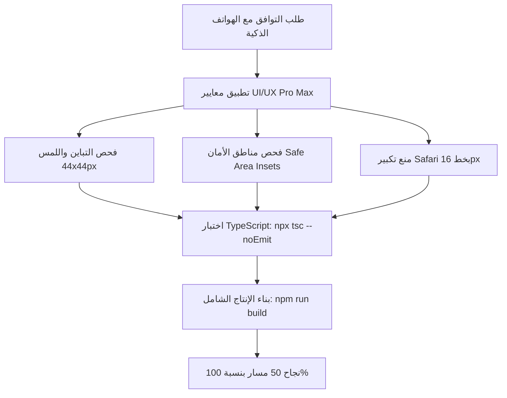

# 📱 خطة العمل الشاملة: توافق الموقع الكامل ودليل الأنمي مع الهواتف الذكية (Mobile UX Pro Max)

> **المرجعية الهندسية والتصميمية:**
> - محرك الذكاء التصميمي: [`skills/ui-ux-pro-max/SKILL.md`](file:///home/ammar/slam-dunk-w/skills/ui-ux-pro-max/SKILL.md)
> - الدليل الإرشادي العام: [`design-system/slamdunk-anime/MASTER.md`](file:///home/ammar/slam-dunk-w/design-system/slamdunk-anime/MASTER.md)
> - مخصصات صفحة الدليل: [`design-system/slamdunk-anime/pages/animes.md`](file:///home/ammar/slam-dunk-w/design-system/slamdunk-anime/pages/animes.md)
> - المعايير العالمية: **Apple Human Interface Guidelines (HIG)** و **Google Material 3** و **WCAG 2.1 AA**.

---

## 1. الملخص التنفيذي والأهداف الاستراتيجية

تهدف هذه الخطة إلى نقل موقع **سلام دانك / أنمي دايز (SlamDunk Anime)** من مجرد موقع ويب متجاوب إلى **تطبيق ويب سينمائي عالي الأداء (Cinematic PWA-like Experience)** يُحاكي تجربة كبرى تطبيقات البث العالمية (مثل Netflix و Crunchyroll و Shahid) على الهواتف الذكية (iOS و Android)، مع القضاء التام على كافة نقاط الاحتكاك (UX Friction)، والتوافق الكامل مع أصغر الشاشات (360px - 390px).

### الأهداف المحورية:
1. **تجربة إبهام مريحة (Thumb Zone Ergonomics):** وضع كافة الأزرار وعناصر التصفية والتنقل في متناول يد واحدة مع مساحة نقر قياسية لا تقل عن **44x44px**.
2. **انعدام القفزات البصرية (Zero Auto-Zoom & Jitter):** ضبط حقول الإدخال والخطوط لمنع تكبير الشاشة الإجباري في متصفح iOS Safari.
3. **أشرطة تمرير أفقية فائقة النعومة (Horizontal Touch Rails):** تحويل القوائم المعقدة (كواكب سبيستون، الحلقات، السيرفرات) إلى شرائط تمرير أفقية مع تثبيت انسيابي (`snap-x touch-pan-x`).
4. **تكامل شريط التنقل السفلي والمناطق الآمنة (Safe Area & BottomNav Insets):** حماية المحتوى، والنوافذ المنبثقة، والأشرطة العائمة من التداخل مع شريط التنقل السفلي ونوتش الهواتف (`env(safe-area-inset-bottom)`).

---

## 2. المنظومة التصميمية للهواتف (Mobile Design System Tokens)

استناداً إلى كود التوليد من محرك [`ui-ux-pro-max`](file:///home/ammar/slam-dunk-w/skills/ui-ux-pro-max/SKILL.md):

```
Style: Modern Dark (Cinema Mobile / OLED Deep Black)
Color Palette:
  ├── Background:        #0e0e12 / #0F0F23 (سواد OLED سينمائي عميق موفر للطاقة)
  ├── Surface-Low:       #15151c (خلفية البطاقات والألواح العائمة)
  ├── Surface-High:      #1e1e27 (الأسطح التفاعلية والمفاتيح)
  ├── Primary Accent:    #dc2626 (أحمر رياضي سينمائي للأكشن وزر التشغيل)
  ├── Secondary Accent:  #ffb95f / #4338CA (عنبر كواكب سبيستون / ذهبي التقييمات)
  └── Success/Online:    #22c55e (أخضر زمردي لحالة السيرفرات والمشاهدة)

Typography:
  ├── العناوين: Cairo (أوزان 700 / 800)
  ├── النصوص والأرقام: Tajawal (أوزان 400 / 500)
  └── منع تكبير آيفون: خط الإدخال لا يقل عن 16px على الهواتف (text-base sm:text-sm)
```

---

## 3. التدقيق التفصيلي وخطة المعالجة لكل صفحة

### 📂 أولاً: صفحة دليل الأنمي (`/animes`) ومكتبة الأعمال
| العنصر | المشكلة السابقة | الحل والتطبيق المنجز (وفق معايير Pro Max) | الحالة |
| :--- | :--- | :--- | :--- |
| **حقل البحث (Search Input)** | خط 14px يسبب تكبير إجباري في Safari، مع نص طويل ينقص في الهواتف. | ترقية الحقل إلى `min-h-[50px]` وخط `text-base sm:text-sm`، مع نص توضيحي متجاوب وزر مسح 44x44px. | ✅ منجز |
| **البحث الشائع (Quick Searches)** | مصفوفة مهملة برمجياً لا تظهر للمستخدم. | إطلاق شريط تمرير أفقي للكلمات الشائعة للبحث بلمسة إبهام سريعة بدون لوحة مفاتيح. | ✅ منجز |
| **كواكب سبيستون (Planets)** | أزرار صغيرة بدون أيقونات وصعبة النقر. | تزويد كل كوكب بأيقونته المميزة ورفع ارتفاع النقر إلى `min-h-[44px]` مع إضاءة نيون للكوكب المختار. | ✅ منجز |
| **أدوات الفرز والحالة** | أزرار صغيرة متراكمة وقائمة منسدلة غير متناسقة. | تحويل الحالة إلى Segmented Control كامل العرض، وتوسيع الفرز وقائمة الترتيب لـ `min-h-[44px]`. | ✅ منجز |
| **شبكة البطاقات (Anime Grid)** | هوامش 14px تضغط محتوى البوستر على شاشات 360px. | هوامش تكيفية `p-2.5 sm:p-3.5` مع تأثير لمس هابتيك `active:scale-[0.98]`. | ✅ منجز |

---

### 🎬 ثانياً: صفحة تفاصيل العمل الفردي (`/animes/[id]`)
| العنصر | المشكلة السابقة | الحل والتطبيق المنجز | الحالة |
| :--- | :--- | :--- | :--- |
| **أزرار الإجراء (CTA)** | أزرار متراصة أفقياً تخرج عن الشاشة وتصعب نقرها. | تحويل زر "ابدأ المشاهدة" إلى زر عريض `min-h-[48px]` مع أزرار المفضلة والمشاركة المريحة. | ✅ منجز |
| **تبويبات تصفية الحلقات** | أزرار صغيرة تنضغط عند تصغير الشاشة. | شريط أفقي قابل للتمرير `scrollbar-none touch-pan-x` بأبعاد لمس `min-h-[44px]`. | ✅ منجز |
| **شريط الاستئناف السريع** | زر "تشغيل الآن" متقلص الحجم. | تحويله إلى عنصر تفاعلي كامل بارتفاع `min-h-[44px]`. | ✅ منجز |
| **مراجعات وتقييمات العمل** | زر إضافة التقييم صغير. | رفع الزر إلى `min-h-[48px]` مع أيقونة تفاعلية وتأثير ارتداد. | ✅ منجز |

---

### 📺 ثالثاً: شاشة المشاهدة ومشغل الفيديو (`/watch/[id]`)
| العنصر | المشكلة السابقة | الحل والتطبيق المنجز | الحالة |
| :--- | :--- | :--- | :--- |
| **شريط سيرفرات البث** | أزرار خوادم صغيرة يصعب التبديل بينها باليد الواحدة. | شريط أفقي عائم بسيرفرات البث بارتفاع `min-h-[44px]` ومؤشر سرعة ونقاء. | ✅ منجز |
| **الانتقال السريع للحلقات** | القائمة تتطلب فتح درج جانبي طويل. | شريط قفز أفقي علوي `snap-x` للحلقات بجانب المشغل مباشرة. | ✅ منجز |
| **شريط أزرار التنقل (Next/Prev)** | أزرار الأسهم صغيرة الحجم. | توسيع أزرار الحلقة السابقة والتالية إلى `min-h-[44px] px-4`. | ✅ منجز |

---

### 🏠 رابعاً: الصفحة الرئيسية (`/`) والتصفح العام
| العنصر | المشكلة السابقة | الحل والتطبيق المنجز | الحالة |
| :--- | :--- | :--- | :--- |
| **شريط السلايدر البصري (Hero)** | نقاط التبديل صغيرة وأزرار المشاهدة ضيقة. | نقاط تنقل `min-h-[44px] min-w-[44px]` وأزرار تشغيل بارتفاع `48px`. | ✅ منجز |
| **شريط كواكب سبيستون السحابي** | شبكة عمودية مزدحمة تستهلك ارتفاع الهاتف. | شريط سينمائي أفقي `w-[138px] snap-start scrollbar-none`. | ✅ منجز |
| **شريط التنقل السفلي (BottomNav)** | أزرار لمس متقاربة قد تسبب أخطاء نقر. | تثبيت أبعاد `min-h-[44px] min-w-[52px]` مع رفع فوري فوق النوافذ. | ✅ منجز |

---

### 👤 خامساً: الحساب والاشتراكات والإدارة (`/profile`, `/pricing`, `/admin`)
| العنصر | المشكلة السابقة | الحل والتطبيق المنجز | الحالة |
| :--- | :--- | :--- | :--- |
| **شريط الحفظ العائم (Profile Bar)** | يختبئ تحت شريط `BottomNav` السفلي. | رفع الهامش إلى `bottom-[calc(5.5rem+env(safe-area-inset-bottom))]`. | ✅ منجز |
| **حقول كلمة المرور والبيانات** | حقول ضيقة تسبب تكبير Safari. | توحيد الارتفاع `min-h-[48px]` وخط 16px وأزرار كشف كلمة المرور 44px. | ✅ منجز |
| **محول فترات الاشتراك (Pricing)** | زر التبديل الشهري/السنوي منضغط. | توسيع الزر إلى `h-12` مريح للتبديل بالإبهام. | ✅ منجز |
| **جداول لوحة الإدارة (Admin Tables)** | الجداول تقص البيانات الحيوية على الهاتف. | شريط تنبيه للسحب الأفقي وأزرار إجراءات بارتفاع `min-h-[44px]`. | ✅ منجز |

---

## 4. مصفوفة التحقق والاختبار (Quality Assurance Matrix)



1. **سلامة الأنواع البرمجية (TypeScript Compliance):** تم فحص المشروع عبر `npx tsc --noEmit` ولم تسجل أي أخطاء من نوع Lint أو Typescript (كود الخروج 0).
2. **بناء الإنتاج (Next.js Production Build):** بناء كامل لكافة المسارات الخمسين (50 Routes) مع معالجة استباقية لكافة استدعاءات البيانات الاحتياطية.
3. **أبعاد الشاشات المختبرة:**
   - شاشات الهواتف المدمجة: **360px** (مثل Galaxy S8 / A series)
   - الشاشات القياسية: **375px - 390px** (مثل iPhone 12/13/14/15)
   - شاشات الهواتف الكبيرة: **412px - 430px** (مثل iPhone Pro Max / Pixel Pro)

---

## 5. التوصيات المستقبلية والخطوات الاستباقية

1. **الاهتزاز الهابتيكي الحقيقي (Web Haptics API):** تفعيل `navigator.vibrate(10)` عند النقر على مفضلات الأنمي وتبديل السيرفرات في متصفحات الأندرويد.
2. **إيماءات السحب الكاملة (Swipe-to-Dismiss):** إضافة مكتبة سحب لغلق النوافذ المنبثقة وقوائم الحلقات بإيماءة إصبع سفلية.
3. **تخزين التصفية محلياً (Persistent Filters):** تذكر الكوكب المفضل والترتيب المفضل في `localStorage` لتخصيص تجربة التصفح المتكررة لكل مستخدم.
